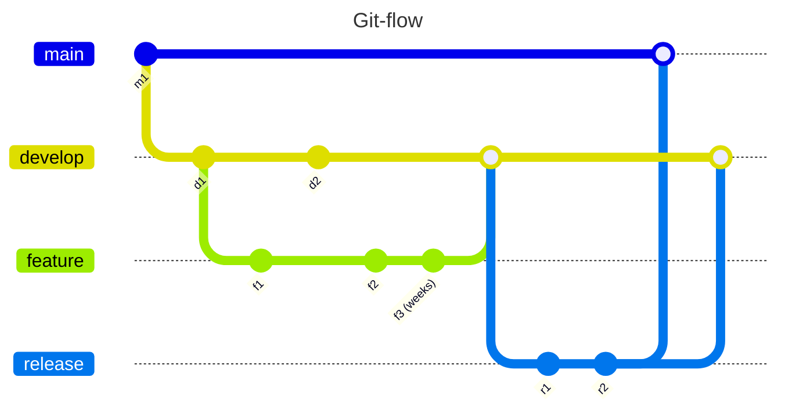
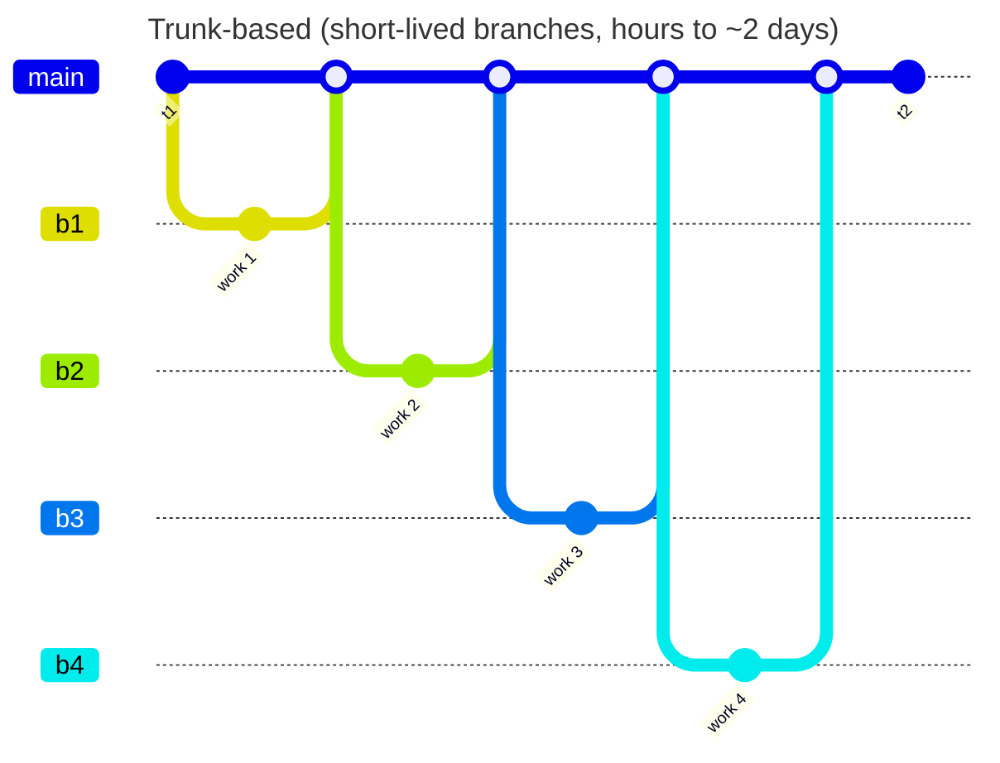
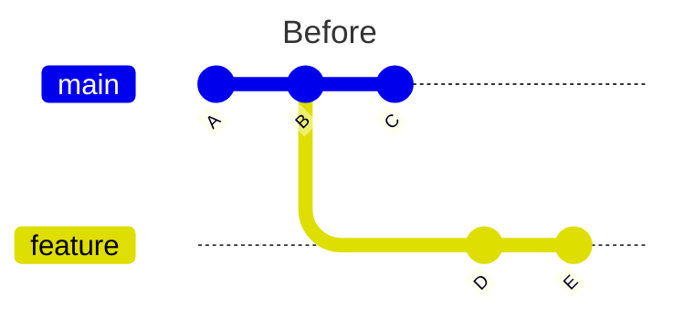
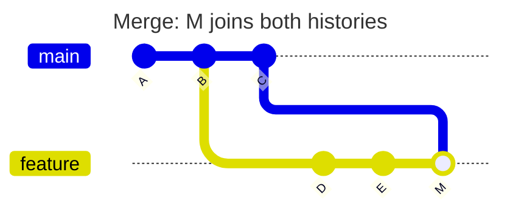
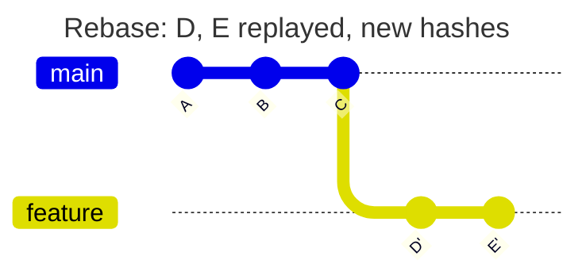

## Why this matters

Solo developers can get away with a `main` branch full of commits named "fix", "wip" and "final final". Teams cannot. Six months later someone runs `git blame` on a line that charges customers twice, finds "misc changes" touching 74 files, and has no idea why the line exists. A 2,000-line PR sits unreviewed for a week, then gets an "LGTM" because nobody can hold it in their head. An important architectural choice gets relitigated every quarter because the reasoning lived in a Slack thread that has since scrolled away.

Git history, pull requests, reviews and design documents are how engineering teams remember and decide. They are also what hiring managers look at when they open your GitHub. This lesson covers the workflow habits that make you effective on a team: how to branch, how to shape commits and PRs, how to review and be reviewed, and how to write down decisions.

## Branching strategies: trunk-based vs git-flow





| | Git-flow | Trunk-based |
|---|---|---|
| Branches | main, develop, release/*, hotfix/*, feature/* | main plus short-lived feature branches |
| Branch lifetime | Days to weeks | Hours to a couple of days |
| Integration | Late, often painful merges | Continuous, small merges |
| Unfinished work | Lives on long branches | Merged behind feature flags |
| Fits | Versioned software with multiple supported releases (mobile apps, libraries, on-prem) | Continuously deployed SaaS |

For a SaaS deployed several times a day, trunk-based development is the default recommendation of the DORA research program, because small batches correlate with lower change failure rates. Long-lived branches drift from main and turn merging into a project of its own. If a feature takes three weeks, ship it in many small PRs behind a flag:

```ts
if (flags.isEnabled("recurring-invoices", { tenantId })) {
  return scheduleRecurring(invoice);
}
```

Remove the flag once the feature is fully rolled out. Stale flags are technical debt.

## Commit hygiene

A good commit is one logical change that builds and passes tests on its own. That makes `git bisect` useful, makes reverts safe, and makes history readable.

Bad history:

```
fix
wip
address comments
fix tests
asdf
```

Better, using the widely adopted Conventional Commits format (optional, but useful for changelogs and release tooling):

```
feat(invoices): add Idempotency-Key support to POST /invoices

Retried requests from the mobile client were creating duplicate
invoices. Store the key with a hash of the request body for 24h and
replay the original response on retry. A different body with the
same key returns 422.

Refs: #412
```

Rules worth following:

- Subject line in the imperative ("add", not "added"), around 50 characters, no trailing period.
- The body explains **why**. The diff already shows what.
- Do not mix a refactor with a behavior change. Rename in one commit, change logic in the next; reviewers can skim the first and focus on the second.
- Never commit secrets, generated files or `node_modules`.

## Rebasing vs merging

Both integrate changes; they differ in how history looks.







Merging creates a merge commit that joins two histories and preserves exactly what happened. Rebasing replays your commits on top of the latest main, producing new commit hashes and a linear history.

| | Merge | Rebase |
|---|---|---|
| History | True, but noisy with merge commits | Linear and readable |
| Rewrites commits | No | Yes (new hashes) |
| Safe on shared branches | Yes | Only if nobody else has the branch |
| Conflicts | Resolved once | Possibly per replayed commit |

Practical workflow for a feature branch:

```bash
git fetch origin
git rebase origin/main            # keep your branch current
git rebase -i origin/main         # optionally squash "fix typo" commits before review
git push --force-with-lease       # never plain --force
```

`--force-with-lease` refuses to overwrite the remote if someone else pushed since your last fetch. The golden rule: do not rebase commits that others have built on.

On merge, most GitHub teams choose **squash merge** (one commit per PR on main, PR title as subject) or **rebase merge** (keep curated commits). Pick one per repo and enforce it in settings.

## Small PRs

Review quality drops sharply with size. Aim for PRs under roughly 400 changed lines that a reviewer can finish in under an hour. Techniques for keeping them small:

- **Stacked PRs**: migration first, then repository, then endpoint, each building on the previous.
- **Preparatory refactors**: "make the change easy, then make the easy change", as separate PRs.
- **Feature flags**: merge incomplete features dark.
- **Separate mechanical changes**: a formatter run or rename touching 80 files is its own PR, labeled as such.

## Writing a PR description

A description is a message to your reviewer and to whoever reads `git log` next year. Keep a template in `.github/pull_request_template.md`:

```markdown
### What
Adds cursor pagination to GET /invoices (replaces offset).

### Why
Offset pagination skipped/duplicated rows when invoices were created
during paging, and page 400 took 2.3s. Closes #388.

### How
- Cursor encodes (issued_at, id) as base64url JSON.
- New composite index invoices(tenant_id, issued_at desc, id desc).
- `offset` param still accepted for one release, logs a deprecation warning.

### Testing
- Unit tests for cursor encode/decode.
- Integration test: inserts during paging, asserts no gaps or duplicates.
- Manually checked p95 on staging: 2.3s -> 18ms on page 400.

### Risk and rollout
Migration builds index CONCURRENTLY. Safe to revert; no data changes.

### Screenshots / notes for reviewer
Start with src/invoices/pagination.ts; the rest is wiring.
```

Self-review your diff on GitHub before requesting review. You will catch half your own comments.

## How to review code

Google's engineering practices guide states the standard well: approve a change once it definitely improves the overall health of the codebase, even if it is not perfect. Review for, roughly in priority order:

1. **Design**: does this belong here? Does it fit the architecture?
2. **Correctness**: edge cases, concurrency, error handling, tenant scoping, security.
3. **Tests**: do they test behavior and would they fail if the code were wrong?
4. **Complexity**: could a teammate change this safely in six months?
5. **Naming, comments, consistency**.
6. **Style**: should be automated by Prettier and ESLint, not argued in comments.

Write comments that are specific, kind and labeled:

```
Bad:  "This is wrong."
Bad:  "Why would you do it like this?"

Good: "This query isn't filtered by tenant_id, so a user from tenant A
       could fetch tenant B's invoice by ID. Could we go through
       InvoiceRepository.findById(tenantId, id) instead?"
Good: "nit: `inv` -> `invoice` for readability. Non-blocking."
Good: "Question: what happens if the Stripe call times out after
       charging? Do we retry with the same idempotency key?"
```

Prefixes like `nit:`, `question:`, `suggestion:` and `blocking:` tell the author what must change before merge. Respond to review requests within one business day; slow reviews are the biggest drag on team throughput.

## Receiving review

- Assume good intent. Comments are about the code, not you.
- Reply to every comment: fix it, or explain why not. "Done" is a fine reply.
- If a thread goes past two rounds, move to a call and write the outcome back on the PR.
- When the same comment keeps appearing across PRs, turn it into a lint rule or a documented convention.

## Branch protection

Process that relies on discipline erodes. Encode it on GitHub with branch protection rules or the newer **repository rulesets** (Settings, Rules, Rulesets), which can target multiple branches and be applied across an organization:

- Require a pull request before merging, with at least 1 approval.
- Dismiss stale approvals when new commits are pushed.
- Require status checks to pass (lint, typecheck, test) and branches to be up to date.
- Require conversation resolution.
- Block force pushes and deletions on main.
- Optionally require linear history and signed commits.

You can inspect them from the CLI:

```bash
gh api repos/OWNER/REPO/rulesets
gh pr create --fill --base main
gh pr checks --watch
```

Add a `CODEOWNERS` file so changes under `src/billing/` automatically request review from the billing owners.

## Architecture Decision Records

An ADR is a short document capturing one significant decision, its context and its consequences. ADRs are immutable once accepted: if you change your mind, write a new ADR that supersedes the old one. Store them in the repo (`docs/adr/0003-use-postgres-rls.md`) so they are versioned and reviewed like code.

```markdown
# ADR 0003: Enforce tenant isolation with Postgres row-level security

Status: Accepted (2026-03-14)
Deciders: @lead, @backend-team

### Context
All tenants share one database. Isolation currently depends on every
query including `WHERE tenant_id = $1`. A missed filter in the export
job leaked rows in staging last month.

### Decision
Enable RLS on all tenant-owned tables. The app sets
`app.tenant_id` per transaction; policies filter on it. Repository-level
scoping stays as the first line of defense.

### Alternatives considered
- Schema per tenant: strong isolation, but migrations x 900 tenants.
- Application-only scoping with lint rules: cheaper, no DB backstop.

### Consequences
+ A forgotten WHERE clause returns zero rows instead of leaking data.
- Every connection must set the tenant; pooled connections need care.
- Migrations and admin jobs need a role with BYPASSRLS.
```

Write an ADR when a decision is hard to reverse, affects multiple teams, or will predictably be questioned later. Do not write them for choices a PR description can explain.

## Lightweight design docs

For work larger than a few days, write a 1 to 3 page design doc before coding. The cost is an afternoon; the payoff is finding the flaw in review instead of in production. A useful outline:

1. **Context and problem**: what is broken or missing, with numbers.
2. **Goals and non-goals**: non-goals prevent scope creep.
3. **Proposed design**: diagram, data model, API changes.
4. **Alternatives considered** and why they lost.
5. **Risks, rollout and migration plan**.
6. **Open questions**.

Share it, collect comments for a few days, then record the outcome. The key decisions become ADRs.

## Writing READMEs

A README answers, in order: what this is, how to run it locally in under 10 minutes, how to run tests, how it is deployed, and where to find more (architecture docs, ADRs). Test it by following it on a clean machine or in a fresh container. For portfolio repos, add a short "design decisions" section linking to your ADRs: it is the fastest way for a reviewer to see how you think.

## Common mistakes

- **Long-lived feature branches** that need a multi-day merge at the end.
- **Mega-PRs** mixing a refactor, a formatter run and a feature.
- **Commit messages that describe the diff** ("change x to y") instead of the reason.
- **Rebasing a shared branch** and force-pushing over a teammate's work.
- **Rubber-stamp reviews** that only look at style, or nitpick wars that ignore design.
- **ADRs written after the fact** to justify a decision, or never updated with a superseding record.
- **Branch protection that admins bypass** "just this once", every week.

## In the real world

At most product companies, every change to main goes through a PR with at least one approval and green CI; nobody, including the CTO, pushes directly. Review turnaround is a tracked team metric. Staff engineers are judged heavily on the quality of their design docs and reviews, not just their code. ADR folders in repos like those at Spotify, GOV.UK and many open-source projects let new hires understand why the system looks the way it does.

In interviews, "tell me about a time you disagreed in a code review" and "how do you keep PRs reviewable?" are standard behavioral questions. Concrete answers referencing small PRs, flags and written decisions stand out.

## Try it

1. In a personal repo, enable a ruleset on `main` requiring a PR, one passing status check and no force pushes.
2. Add `.github/pull_request_template.md` using the template above.
3. Take your last messy branch, run `git rebase -i origin/main`, and rewrite it into 2 to 4 logical commits with "why" bodies.
4. Write `docs/adr/0001-record-architecture-decisions.md` and one real ADR for a decision you already made (your ORM, your auth approach).
5. Open a PR, review it yourself on GitHub as if it were a stranger's, and leave at least three labeled comments.
