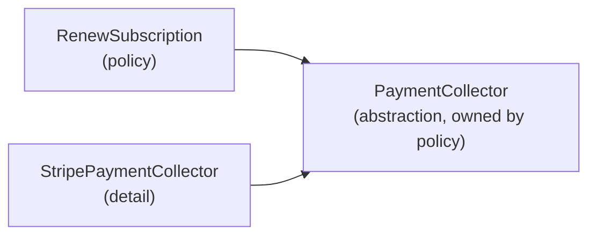

## Why this matters

Every long-lived codebase has a file people are afraid of. In ERPs it's usually `InvoiceService.ts`, at 2,000 lines. It calculates totals, applies discounts, renders PDFs, sends emails, posts to the ledger and syncs with the accounting integration. Adding a new discount type means editing a 300-line `switch`. Fixing the PDF footer breaks a test about tax. Two developers can't work on it at once without merge conflicts.

SOLID is five principles, collected by Robert C. Martin, that describe *why* that file became frightening and *how* to stop the next one from getting there. They aren't laws. They're heuristics for keeping code **easy to change**, which is the only quality that matters once software has users.

| Letter | Principle | One-line version |
|---|---|---|
| S | Single Responsibility | A module should have one reason to change |
| O | Open/Closed | Add behavior by adding code, not by editing working code |
| L | Liskov Substitution | Subtypes must honor the contract of their parent |
| I | Interface Segregation | Don't force clients to depend on methods they don't use |
| D | Dependency Inversion | Depend on abstractions you own, not on concrete details |

Each principle below has a realistic bad example, what's wrong with it, and a refactor.

## S: Single Responsibility Principle

"One responsibility" is often misread as "one function" or "one thing." Martin's definition is sharper: **a module should be responsible to one actor**, meaning one group of people who request changes.

### Bad

```ts
class InvoiceService {
  calculateTotal(inv: Invoice): number { /* tax + discounts: owned by Finance */ }
  renderPdf(inv: Invoice): Buffer { /* layout, logo, fonts: owned by Design/Sales */ }
  async save(inv: Invoice) { /* SQL: owned by Engineering */ }
  async emailToCustomer(inv: Invoice) { /* templates, SMTP: owned by Customer Success */ }
}
```

Four actors share one class. When Sales asks for a new PDF footer, the developer opens a file that also holds tax math. A careless edit or a bad merge can break finance numbers. Testing `calculateTotal` means constructing a class that needs a DB connection and an SMTP client.

### Better

```ts
class InvoiceCalculator { total(inv: Invoice): Money { /* ... */ } }
class InvoicePdfRenderer { render(inv: Invoice): Promise<Buffer> { /* ... */ } }
interface InvoiceRepository { save(inv: Invoice): Promise<void> }
class InvoiceMailer { constructor(private mailer: Mailer, private pdf: InvoicePdfRenderer) {} /* ... */ }
```

Each class now changes for one reason. A PDF tweak can't touch tax logic, and each piece can be tested on its own.

**Heuristic:** if describing a class needs the word "and" ("it calculates totals *and* sends email"), it probably has more than one responsibility.

## O: Open/Closed Principle

**Open for extension, closed for modification.** When requirements grow along a predictable axis (new payment providers, new discount types, new export formats), you should be able to add a new unit of code without editing the code that already works.

### Bad

```ts
function applyDiscount(sub: Subscription, code: DiscountCode): Money {
  switch (code.type) {
    case "percent":
      return sub.price.multiply(1 - code.value / 100);
    case "fixed":
      return sub.price.subtract(Money.of(code.value, sub.price.currency));
    case "first_month_free":
      return sub.isFirstPeriod ? Money.zero(sub.price.currency) : sub.price;
    // next sprint: "annual_20", "partner_tier", "volume" ... each edits this function
  }
}
```

Every new discount edits a central function that every billing path depends on. The `switch` usually gets copied too: one in the calculation, one in the admin UI label, one in the validation.

### Better: strategy pattern

```ts
interface DiscountRule {
  readonly type: string;
  apply(sub: Subscription): Money;
}

class PercentDiscount implements DiscountRule {
  readonly type = "percent";
  constructor(private pct: number) {}
  apply(sub: Subscription) { return sub.price.multiply(1 - this.pct / 100); }
}

class FirstMonthFree implements DiscountRule {
  readonly type = "first_month_free";
  apply(sub: Subscription) { return sub.isFirstPeriod ? Money.zero(sub.price.currency) : sub.price; }
}

// adding VolumeDiscount = a new file + one registry line; no existing rule changes
const registry: Record<string, (value: number) => DiscountRule> = {
  percent: (v) => new PercentDiscount(v),
  first_month_free: () => new FirstMonthFree(),
};
```

**Caveat:** OCP is about *expected* axes of change. Don't build a plugin system for something that has changed once in three years. A `switch` with three stable cases is fine. Refactor toward OCP when the third or fourth variant appears, not when the first one does.

## L: Liskov Substitution Principle

If code works with a `T`, it must keep working when handed any subtype of `T`. Subtypes may not **strengthen preconditions** (demand more), **weaken postconditions** (promise less), or throw surprising errors.

### Bad

```ts
interface PaymentGateway {
  charge(customerId: string, amount: Money): Promise<ChargeResult>;
  refund(chargeId: string, amount: Money): Promise<RefundResult>;
}

class BankTransferGateway implements PaymentGateway {
  async charge(customerId: string, amount: Money) { /* creates a pending transfer */ }
  async refund(): Promise<RefundResult> {
    throw new Error("Bank transfers cannot be refunded automatically");
  }
}

// elsewhere, written against the interface:
async function cancelOrder(order: Order, gateway: PaymentGateway) {
  await gateway.refund(order.chargeId, order.total); // explodes for bank transfers
}
```

`BankTransferGateway` type-checks, but it violates the contract. Every caller now needs `if (gateway instanceof BankTransferGateway)`, which defeats the abstraction.

### Better: model what's really true

```ts
interface PaymentGateway {
  charge(customerId: string, amount: Money): Promise<ChargeResult>;
}
interface RefundableGateway extends PaymentGateway {
  refund(chargeId: string, amount: Money): Promise<RefundResult>;
}

class StripeGateway implements RefundableGateway { /* both */ }
class BankTransferGateway implements PaymentGateway { /* charge only */ }

// a type guard keeps the capability check in one place
const isRefundable = (g: PaymentGateway): g is RefundableGateway =>
  typeof (g as Partial<RefundableGateway>).refund === "function";

async function cancelOrder(order: Order, gateway: PaymentGateway, refunds: ManualRefundQueue) {
  if (isRefundable(gateway)) await gateway.refund(order.chargeId, order.total);
  else await refunds.enqueue(order); // explicit, typed path for the manual process
}
```

Smaller signs of an LSP violation: a subclass that overrides a method to do nothing, a subtype that rejects inputs the parent accepts (`min amount 10 EUR`), or a `ReadOnlyRepository extends Repository` whose `save` throws. The classic textbook case is `Square extends Rectangle`, where setting the width also changes the height. That breaks callers who assume they're independent.

**In TypeScript,** structural typing means LSP matters for *interfaces* at least as much as for class inheritance. Implementing an interface is a promise about behavior, not only about shape.

## I: Interface Segregation Principle

Clients shouldn't be forced to depend on methods they don't use. Fat interfaces create coupling: every implementer has to implement everything, and every consumer is affected when any of it changes.

### Bad

```ts
interface InventoryStore {
  getStockLevel(sku: string, warehouseId: string): Promise<number>;
  reserve(sku: string, qty: number): Promise<void>;
  release(reservationId: string): Promise<void>;
  adjust(sku: string, delta: number, reason: string): Promise<void>;
  valuationReport(asOf: Date): Promise<ValuationRow[]>;
  exportCsv(): Promise<string>;
  syncWithShopify(): Promise<void>;
}
```

The storefront's "in stock?" badge only needs `getStockLevel`. Its test fake must still stub seven methods. The reporting team's change to `valuationReport` forces the storefront to recompile and re-review.

### Better: role interfaces

```ts
interface StockReader { getStockLevel(sku: string, warehouseId: string): Promise<number> }
interface StockReservations {
  reserve(sku: string, qty: number): Promise<ReservationId>;
  release(id: ReservationId): Promise<void>;
}
interface StockAdjustments { adjust(sku: string, delta: number, reason: string): Promise<void> }
interface InventoryReporting { valuationReport(asOf: Date): Promise<ValuationRow[]> }

// one class can still implement several roles
class PostgresInventory implements StockReader, StockReservations, StockAdjustments { /* ... */ }

// each consumer asks only for what it needs
class CheckoutService { constructor(private stock: StockReservations) {} }
class ProductBadge   { constructor(private stock: StockReader) {} }
```

Test fakes become one-liners, and the dependencies of each class are self-documenting.

## D: Dependency Inversion Principle

1. High-level modules (business policy) shouldn't depend on low-level modules (details). Both should depend on abstractions.
2. **The abstraction is owned by the high-level module.**

The second point is the one people skip. DIP isn't "put an interface in front of everything." It's that the business layer *defines the shape it needs*, and infrastructure conforms to it.

### Bad

```ts
import Stripe from "stripe";
import { prisma } from "../db";

export class SubscriptionRenewal {
  private stripe = new Stripe(process.env.STRIPE_KEY!);
  async renew(subscriptionId: string) {
    const sub = await prisma.subscription.findUniqueOrThrow({ where: { id: subscriptionId } });
    const pi = await this.stripe.paymentIntents.create({ amount: sub.priceCents, currency: "eur", customer: sub.stripeCustomerId });
    await prisma.subscription.update({ where: { id: sub.id }, data: { periodEnd: addMonths(sub.periodEnd, 1) } });
  }
}
```

Renewal policy, the most valuable logic in a SaaS, is welded to Stripe's SDK shape and Prisma's API. You can't unit test it, and you can't add Paddle for EU customers without rewriting it.

### Better

```ts
// billing/application/ports.ts  (owned by the business layer)
export interface PaymentCollector {
  collect(customerRef: string, amount: Money, idempotencyKey: string): Promise<{ ok: boolean; ref?: string }>;
}
export interface SubscriptionRepository {
  get(id: string): Promise<Subscription>;
  save(sub: Subscription): Promise<void>;
}

// billing/application/renew-subscription.ts
export class RenewSubscription {
  constructor(private subs: SubscriptionRepository, private payments: PaymentCollector) {}
  async execute(id: string) {
    const sub = await this.subs.get(id);
    const result = await this.payments.collect(sub.customerRef, sub.price, `renew:${sub.id}:${sub.periodEnd.toISOString()}`);
    result.ok ? sub.extendOnePeriod() : sub.markPastDue();
    await this.subs.save(sub);
  }
}

// billing/infrastructure/stripe-payment-collector.ts
export class StripePaymentCollector implements PaymentCollector { /* uses the Stripe SDK */ }
```



Dependency Injection (next lesson) is the *technique* that supplies `StripePaymentCollector` to `RenewSubscription` at runtime. DIP is the *principle* that tells you which direction the arrows should point.

## How the principles relate

They reinforce each other. SRP splits code into focused units. ISP keeps the contracts between those units small. DIP points the contracts toward policy. LSP makes sure implementations behind a contract are truly interchangeable. OCP is what you get as a result: new behavior arrives as new implementations plugged into existing contracts.

## Common mistakes

- **Interface-per-class by reflex.** `IUserService` with a single `UserService` implementation and no second consumer is ceremony, not DIP. Add abstractions at *volatile boundaries*: I/O, third parties, and policies that vary.
- **Splitting too finely for SRP.** Ten one-method classes that always change together are one responsibility spread across ten files. Cohesion matters as much as separation.
- **Premature OCP.** Strategy registries for a switch that has never grown. Wait for the third variant.
- **Ignoring LSP with "not implemented" methods.** `throw new Error("not supported")` in an implementation is almost always a sign the interface is too broad, which is ISP's job to fix.
- **Treating SOLID as a scoring checklist.** The goal is cheaper change. If a refactor makes the code harder to follow without making a likely change easier, undo it.

## In the real world

- In code review, SOLID gives you shared vocabulary: "This class has two actors, Finance and Ops, so let's split it (SRP)" carries more weight than "this feels big."
- Payment, email, storage and tax providers are where DIP and OCP pay off most in SaaS. Companies regularly migrate from one provider to another, and teams that used a port do it in days instead of months.
- **Interviews:** "Explain SOLID" is common, but strong candidates answer with a concrete example from their own code: "Our invoice service mixed PDF rendering with tax rules, so we split it by actor." Expect follow-ups like "When would you *not* apply OCP?" Have an answer about premature abstraction ready.
- Many senior engineers stress *YAGNI* and *cohesion* alongside SOLID. Knowing the tension between them is a sign of maturity.

## Try it

Take this class and refactor it, applying at least three principles. Write down which principle drove each change.

```ts
class ReportService {
  async monthlyRevenue(tenantId: string, format: "csv" | "pdf" | "xlsx") {
    const rows = await prisma.invoice.findMany({ where: { tenantId, status: "paid" } });
    const total = rows.reduce((s, r) => s + r.total, 0);
    if (format === "csv") return rows.map((r) => `${r.id},${r.total}`).join("\n");
    if (format === "pdf") return await new PdfKit().render(rows, total);
    if (format === "xlsx") return await new ExcelJs().build(rows, total);
  }
}
```

Hints: who asks for changes to revenue rules versus export formats? What happens when "json" is requested? What does the report logic actually need from the database?
