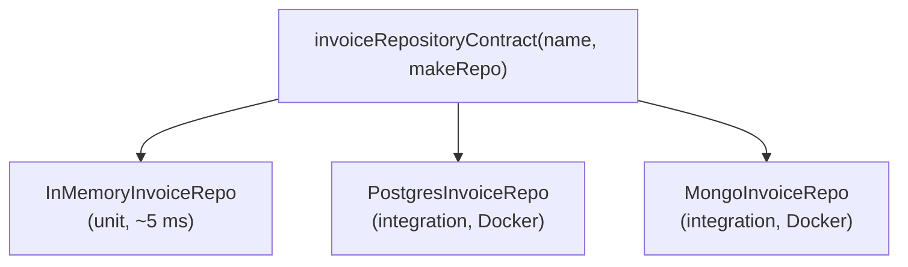

## Why this matters

Most self-taught developers learn testing backwards. They ship for a year, a production bug costs a weekend, and then they try to bolt tests onto a codebase where every function imports `prisma` and `stripe` directly. The first test needs a seeded database, a mocked SDK and 40 lines of setup. It's slow, it flakes, and the team quietly stops writing more.

The previous lessons removed the reason that happens. Once business rules live in the domain, use cases receive their dependencies through constructors, and persistence sits behind a repository port, testing stops being a heroic effort. A use-case test is a few lines of plain TypeScript that runs in milliseconds without Docker.

That's why this course asks for tests in every Phase 1 problem rather than waiting for Phase 4. Tests are also the cheapest way to prove your architecture is real. If you can't test `IssueInvoice` without a database, a port is missing. If your in-memory repository and your Postgres repository behave differently, your fakes are lying and your unit tests are worth less than you think.

This lesson is a practical primer: enough to set up a project and write the three kinds of tests Phase 1 needs. Phase 4 goes much deeper into test design, integration testing with real Postgres, and CI.

## Setting up Vitest in a TypeScript project

Vitest is the default choice for new TypeScript projects. It runs `.ts` files directly (it transforms them with esbuild, so there's no `ts-jest` setup), has a Jest-compatible API, and its watch mode reruns only the tests affected by a change.

```sh
npm install -D vitest
```

A config with two projects, so fast unit tests and slower database tests can run separately (the `projects` option exists in Vitest 3.2 and later; older versions used a separate workspace file):

```ts
// vitest.config.ts
import { defineConfig } from "vitest/config";

export default defineConfig({
  test: {
    projects: [
      {
        test: {
          name: "unit",
          include: ["src/**/*.test.ts", "test/contracts/in-memory.*.test.ts"],
          environment: "node",
        },
      },
      {
        test: {
          name: "integration",
          include: ["test/integration/**/*.test.ts", "test/contracts/{postgres,mongo}.*.test.ts"],
          environment: "node",
          testTimeout: 30_000,
          fileParallelism: false, // tests share one database; don't run files concurrently
        },
      },
    ],
  },
});
```

```json
{
  "scripts": {
    "test": "vitest run --project unit",
    "test:watch": "vitest --project unit",
    "test:int": "vitest run --project integration",
    "typecheck": "tsc --noEmit"
  }
}
```

Three practical notes:

- **Vitest does not type-check.** It strips types and runs the JavaScript. Run `tsc --noEmit` as its own script (and in CI), otherwise a test can pass while the file doesn't compile.
- **Path aliases** such as `@/modules/...` are not read from `tsconfig.json` automatically. Add the `vite-tsconfig-paths` plugin or mirror the aliases in `resolve.alias`.
- **Import the API explicitly** (`import { describe, it, expect } from "vitest"`). The `globals: true` option exists, but explicit imports keep editors and type checking simple.

## Testing a use case with in-memory fakes

Here's a use case from the capstone domain, written with constructor injection as in the dependency injection lesson:

```ts
// modules/invoicing/application/issue-invoice.ts
export class IssueInvoice {
  constructor(
    private readonly invoices: InvoiceRepository,
    private readonly numbers: InvoiceNumberSequence,
    private readonly clock: Clock,
  ) {}

  async execute(tenantId: string, invoiceId: string): Promise<Invoice> {
    const invoice = await this.invoices.findById(tenantId, invoiceId);
    if (!invoice) throw new NotFoundError("invoice", invoiceId);
    const now = this.clock.now();
    const number = await this.numbers.next(tenantId, now.getUTCFullYear());
    invoice.issue(number, now); // domain rule: only drafts with at least one line
    await this.invoices.save(invoice);
    return invoice;
  }
}
```

The fakes are small, working implementations of the ports. They live next to the tests (or in a `test/fakes` folder) and implement the real interfaces, so the compiler tells you when a port changes:

```ts
// test/fakes/in-memory-invoice-repository.ts
export class InMemoryInvoiceRepository implements InvoiceRepository {
  private rows = new Map<string, Invoice>();

  async findById(tenantId: string, id: string) {
    const found = this.rows.get(id);
    return found && found.tenantId === tenantId ? found : null; // tenant scoping, like the real one
  }
  async save(invoice: Invoice) {
    this.rows.set(invoice.id, invoice);
  }
}

export class FakeInvoiceNumbers implements InvoiceNumberSequence {
  private counters = new Map<string, number>();
  async next(tenantId: string, year: number) {
    const key = `${tenantId}:${year}`;
    const n = (this.counters.get(key) ?? 0) + 1;
    this.counters.set(key, n);
    return `INV-${year}-${String(n).padStart(5, "0")}`;
  }
}

export const fixedClock = (iso: string): Clock => ({ now: () => new Date(iso) });
```

One subtlety: the in-memory repository stores object references, so a test could mutate an aggregate without calling `save` and still see the change. Real databases don't work that way. If that matters for a test, store a copy (`structuredClone` works for plain data; for classes, rebuild through the same mapping functions the real repository uses).

Now the tests read like business specifications:

```ts
// modules/invoicing/application/issue-invoice.test.ts
import { describe, it, expect, beforeEach } from "vitest";

describe("IssueInvoice", () => {
  let invoices: InMemoryInvoiceRepository;
  let issue: IssueInvoice;

  beforeEach(() => {
    invoices = new InMemoryInvoiceRepository();
    issue = new IssueInvoice(invoices, new FakeInvoiceNumbers(), fixedClock("2026-03-15T09:00:00Z"));
  });

  it("assigns the first number of the year to the first issued invoice", async () => {
    await invoices.save(aDraftInvoice({ id: "inv-1", tenantId: "t1" }).withLine("SKU-1", 2, "19.99"));

    const issued = await issue.execute("t1", "inv-1");

    expect(issued.status).toBe("issued");
    expect(issued.number).toBe("INV-2026-00001");
  });

  it("refuses to issue an empty draft", async () => {
    await invoices.save(aDraftInvoice({ id: "inv-2", tenantId: "t1" }));
    await expect(issue.execute("t1", "inv-2")).rejects.toThrow(DomainError);
  });

  it("does not find another tenant's invoice", async () => {
    await invoices.save(aDraftInvoice({ id: "inv-3", tenantId: "t2" }).withLine("SKU-1", 1, "5.00"));
    await expect(issue.execute("t1", "inv-3")).rejects.toThrow(NotFoundError);
  });
});
```

`aDraftInvoice(...)` is a **test data builder**: a small helper that creates a valid aggregate with sensible defaults, so each test states only the details it cares about. When the `Invoice` constructor gains a field, you fix one builder instead of 60 tests.

### Fakes, stubs, spies and mocks

| Kind | What it is | Use it for |
|---|---|---|
| Fake | A working, simplified implementation (`InMemoryInvoiceRepository`) | Repositories, sequences, queues: anything with state |
| Stub | Returns canned answers (`{ seatLimit: async () => 5 }`) | Read-only ports where only the answer matters |
| Spy | Records calls (`vi.fn()` or a `sent: string[]` array) | Checking that a side effect happened, such as an email |
| Mock | Pre-programmed expectations about calls | Rarely needed; tests become coupled to implementation steps |

Prefer asserting on **outcomes** (the invoice is issued, the fake mailer holds one message) over asserting on **interactions** (`save` was called with exactly these arguments). Outcome tests survive refactoring. Avoid `vi.mock("../infrastructure/...")` module patching for your own code: if you need it, a dependency is being imported instead of injected.

## Contract tests: one suite, every implementation

A fake is only useful if it behaves like the real thing. The way to guarantee that is a **contract test suite**: a function that takes a factory and registers the same tests for any implementation of a port.

```ts
// test/contracts/invoice-repository.contract.ts
import { describe, it, expect, beforeEach } from "vitest";

export function invoiceRepositoryContract(
  name: string,
  makeRepo: () => Promise<InvoiceRepository>, // must return a repository over EMPTY storage
) {
  describe(`InvoiceRepository contract: ${name}`, () => {
    let repo: InvoiceRepository;
    beforeEach(async () => {
      repo = await makeRepo();
    });

    it("returns null for an unknown id", async () => {
      expect(await repo.findById("t1", "missing")).toBeNull();
    });

    it("round-trips an aggregate with its lines and money intact", async () => {
      const draft = aDraftInvoice({ id: "inv-1", tenantId: "t1" }).withLine("SKU-1", 3, "0.10");
      await repo.save(draft);
      const loaded = await repo.findById("t1", "inv-1");
      expect(loaded?.lines).toHaveLength(1);
      expect(loaded?.subtotal().toString()).toBe("0.30 EUR"); // no float drift through storage
    });

    it("updates on second save instead of duplicating", async () => {
      const draft = aDraftInvoice({ id: "inv-2", tenantId: "t1" }).withLine("SKU-1", 1, "5.00");
      await repo.save(draft);
      draft.issue("INV-2026-00001", new Date("2026-01-02T00:00:00Z"));
      await repo.save(draft);
      expect((await repo.findById("t1", "inv-2"))?.status).toBe("issued");
    });

    it("never returns another tenant's invoice", async () => {
      await repo.save(aDraftInvoice({ id: "inv-3", tenantId: "t2" }));
      expect(await repo.findById("t1", "inv-3")).toBeNull();
    });
  });
}
```

Each implementation gets a tiny test file that calls the suite:

```ts
// test/contracts/in-memory.invoice-repository.test.ts  (unit project)
invoiceRepositoryContract("in-memory", async () => new InMemoryInvoiceRepository());

// test/contracts/postgres.invoice-repository.test.ts  (integration project)
const pool = new Pool({ connectionString: process.env.TEST_DATABASE_URL });
afterAll(() => pool.end());

invoiceRepositoryContract("postgres", async () => {
  await pool.query("TRUNCATE invoice_lines, invoices");
  return new PostgresInvoiceRepository(pool);
});
```



When all of them pass, the implementations are substitutable in the Liskov sense, and use-case tests that rely on the in-memory fake are trustworthy. When a new bug is found in one adapter (say, Postgres returned lines in the wrong order), add the case to the shared suite so every implementation is held to it. This is exactly how the capstone proves that PostgreSQL and MongoDB are interchangeable.

## What to test, and what not to

| Test this | Skip or test lightly |
|---|---|
| Domain invariants: status transitions, totals, rounding, oversell rules | Getters, setters and plain data types |
| Use-case orchestration: not-found, conflicts, tenant scoping, side effects | Framework behavior (that Express routes, that zod parses) |
| Repository mapping and queries, via the contract suite | The ORM itself |
| Error-to-HTTP mapping and DTO shape (for example, no `password_hash`) | Every permutation already covered at a lower level |
| Edge cases: zero, negative, boundary dates, half-even rounding at `0.005` | Private methods directly; test them through the public API |

A useful default for Phase 1 projects: many fast tests on the domain and use cases, a contract suite per repository, and a handful of HTTP tests (with Supertest or the framework's inject helper) that confirm wiring and status codes. Coverage numbers are a weak signal; a tested rounding edge case is worth more than 100% line coverage of mappers.

## Keeping tests fast

Speed decides whether people run tests. Aim for the unit project to finish in about a second or two, so it can run on every save.

- **No I/O in unit tests.** No database, network, filesystem or real timers. Inject `Clock` and `IdGenerator` so time and IDs are deterministic.
- **Fresh state per test.** Build fakes in `beforeEach`. Shared mutable fixtures cause order-dependent failures that only show up in CI.
- **Isolate the integration project.** Start Postgres once (docker compose or Testcontainers), run migrations once in a global setup, and `TRUNCATE` in `beforeEach`. Run those files serially if they share a database.
- **Use fake timers only for real waiting.** For retries or debounces, `vi.useFakeTimers()` and `vi.advanceTimersByTime()` beat real sleeps. For business dates, an injected clock is simpler.
- **Watch mode during development.** `vitest` without `run` reruns affected tests on every save.

## Common mistakes

- **Fakes that drift from reality.** The in-memory repository ignores `tenantId` or returns lines unsorted, so unit tests pass while production leaks data. Run the contract suite against the fakes too.
- **Mocking your own modules.** `vi.mock("@/lib/db")` couples tests to file paths and import structure. Inject a port instead.
- **Asserting on implementation steps.** `expect(repo.save).toHaveBeenCalledTimes(2)` breaks on harmless refactors. Assert the observable outcome.
- **One giant test per feature.** A 200-line test that creates, issues, pays and voids an invoice fails with no clear cause. One behavior per test, named as a business sentence.
- **Real time and randomness.** `new Date()` and `crypto.randomUUID()` inside domain code make tests flaky around month-end and impossible to snapshot. Inject them.
- **Skipping type checks.** Relying on Vitest alone lets type errors through, because it doesn't run the compiler.

## In the real world

- Teams that practice ports and adapters usually have a `test/fakes` or `testing/` folder per module with in-memory adapters that are reused by tests and sometimes by local development, plus contract suites that keep those adapters honest.
- Contract suites are common for anything with several implementations: storage adapters, payment providers in sandbox mode, cache layers, and feature-flag clients.
- CI typically runs `typecheck`, `lint` and the unit project on every push in under a minute, and the integration project with service containers. Phase 4 builds that pipeline.
- **Interviews:** "How do you test business logic that touches the database?" A strong answer: domain and use-case tests with in-memory fakes injected through constructors, a shared contract suite that runs against both the fake and the real repository, and a small number of integration tests against a real database. Then mention what you deliberately don't test.

Phase 4 (unit testing business logic, and integration testing with Postgres) covers test design, test data strategies, Testcontainers and CI in depth. This lesson gives you enough to start now.

## Try it

1. Add Vitest to one of your projects with the two-project config above and the four npm scripts.
2. Pick one use case that already uses constructor injection (or refactor one using the dependency injection lesson). Write three tests: the happy path, one business-rule failure, and one tenant-isolation case, using hand-written fakes.
3. Write a contract suite with four cases for its repository and run it against your in-memory fake.
4. Run the same suite against the real database. Fix whichever implementation fails, and note which bugs the fake had been hiding.
5. Time `npm test`. If it takes more than two seconds, find the test doing I/O.
