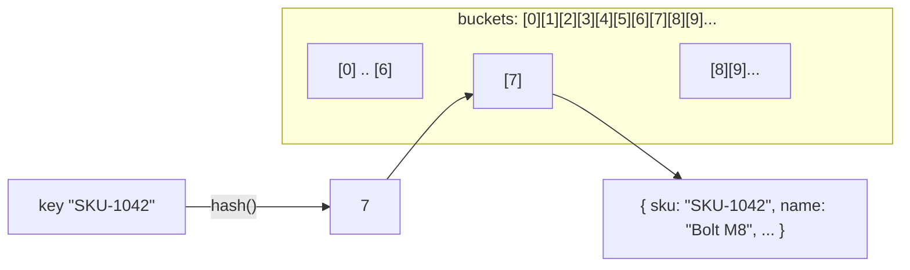

## Why this matters

A purchase-order import job takes a CSV of 8,000 lines and, for each line, looks up the product by SKU and the supplier by code from arrays loaded at the start of the job. It worked fine when the catalog had 300 products. Now the catalog has 40,000 products, and the import takes four minutes. Customer support is filing tickets because the import page "hangs".

The fix is about ten lines of code: build a lookup map once, then read from it. The import drops to under a second. That ten-line change is the single most valuable data structure move you will make as a backend developer, and it applies everywhere: matching, joining, deduplicating, grouping, counting.

This lesson makes that move automatic, and covers the details that trip people up: `Map` vs plain objects, `Set`, key design, and the grouping and indexing patterns you will use weekly.

## Arrays: what they are good and bad at

An array is a contiguous, ordered list. Its strengths come from position:

| Operation | Cost | Notes |
|---|---|---|
| `arr[i]` read by index | `O(1)` | Direct offset into memory |
| `push` / `pop` at the end | `O(1)` amortized | |
| `unshift` / `shift` at the start | `O(n)` | Every element shifts |
| `splice` in the middle | `O(n)` | |
| `find` / `includes` / `indexOf` by value | `O(n)` | Must scan |
| Iterate in order | `O(n)` | Very cache-friendly, fast in practice |

Arrays are the right choice when you care about **order** or **position**: line items on an invoice, rows in a report, a page of results. They are the wrong choice when you need to answer "do I have the item with key X?" repeatedly.

## Hash maps: lookup by key

A hash map stores key-value pairs. It runs the key through a hash function to compute a bucket location, so finding a key does not require scanning.



| Operation | Average cost |
|---|---|
| `get(key)` | `O(1)` |
| `set(key, value)` | `O(1)` amortized |
| `has(key)` | `O(1)` |
| `delete(key)` | `O(1)` |
| Iterate all entries | `O(n)` |

"Instant" is shorthand. A lookup does real work: hash the key, find the bucket, compare keys. It is roughly constant regardless of size, which is the point. For 40,000 products, a scan averages 20,000 comparisons; a Map lookup is a handful of operations.

## The core move: index once, look up many

### Slow: nested scan

```ts
type Product = { id: string; sku: string; name: string; costPrice: number };
type ImportLine = { sku: string; qty: number };

function priceLines(lines: ImportLine[], products: Product[]) {
  return lines.map((line) => {
    const product = products.find((p) => p.sku === line.sku); // O(P) per line
    if (!product) throw new Error(`Unknown SKU ${line.sku}`);
    return { ...line, productId: product.id, lineCost: product.costPrice * line.qty };
  });
}
// O(L * P): 8,000 * 40,000 = 320,000,000 comparisons
```

### Fast: build a Map, then look up

```ts
function priceLinesFast(lines: ImportLine[], products: Product[]) {
  const bySku = new Map<string, Product>();
  for (const p of products) bySku.set(p.sku, p); // O(P), once

  return lines.map((line) => {
    const product = bySku.get(line.sku); // O(1)
    if (!product) throw new Error(`Unknown SKU ${line.sku}`);
    return { ...line, productId: product.id, lineCost: product.costPrice * line.qty };
  });
}
// O(P + L): 40,000 + 8,000 = 48,000 operations
```

That is a 6,000x reduction in work. On a laptop: several seconds down to a few milliseconds.

The pattern generalizes: **whenever you are about to search one collection inside a loop over another, build a Map of the searched collection first.** This is exactly what a database hash join does internally.

## Sets: membership without values

A `Set` is a hash map with keys only. Use it when the question is "is X in this group?"

```ts
// Slow: O(n * m)
const activeIds: string[] = await getActiveCustomerIds();
const toBill = invoices.filter((inv) => activeIds.includes(inv.customerId));

// Fast: O(n + m)
const active = new Set(await getActiveCustomerIds());
const toBill2 = invoices.filter((inv) => active.has(inv.customerId));
```

Common Set jobs in business code:

```ts
// Deduplicate
const uniqueEmails = [...new Set(contacts.map((c) => c.email.toLowerCase()))];

// Find SKUs in the import that do not exist in the catalog
const known = new Set(products.map((p) => p.sku));
const unknown = lines.filter((l) => !known.has(l.sku));

// Detect duplicates in a single pass
const seen = new Set<string>();
const dupes: string[] = [];
for (const inv of invoices) {
  if (seen.has(inv.number)) dupes.push(inv.number);
  else seen.add(inv.number);
}
```

## Map vs plain object in JavaScript

Both can act as dictionaries. They are not equivalent.

| | `Map` | Plain object `{}` |
|---|---|---|
| Key types | Any value (strings, numbers, objects) | Strings and symbols only (numbers are coerced to strings) |
| Prototype keys | None | Inherits `toString`, `constructor`, etc. unless created with `Object.create(null)` |
| Size | `map.size` is `O(1)` | `Object.keys(o).length` is `O(n)` |
| Insertion order | Always preserved | Preserved, except integer-like keys are sorted first |
| Frequent add/delete | Optimized for it | Deletes can push V8 into a slower dictionary mode |
| JSON serialization | Not directly (`Object.fromEntries` first) | Native |
| Iteration | `for (const [k, v] of map)` | `Object.entries(o)` allocates an array |

The integer-key ordering gotcha bites real reports:

```ts
const o: Record<string, number> = {};
o["2024"] = 1; o["INV-9"] = 2; o["15"] = 3;
Object.keys(o); // ["15", "2024", "INV-9"]  -- not insertion order
```

The prototype gotcha bites anything keyed by user input:

```ts
const counts: Record<string, number> = {};
const tag = "constructor"; // from a CSV
counts[tag] = (counts[tag] ?? 0) + 1;
// counts[tag] was the Object function, not undefined: you get "function Object()...1"
```

**Rule of thumb:** use `Map` for runtime lookup tables built from data. Use plain objects for fixed-shape records and things you will serialize to JSON. Convert at the boundary with `Object.fromEntries(map)`.

## Key design

A Map is only as good as its key. Business data often needs composite keys.

```ts
// Inventory is per (warehouse, product). Build a composite string key.
const key = (warehouseId: string, productId: string) => `${warehouseId}|${productId}`;

const stock = new Map<string, number>();
for (const row of stockRows) stock.set(key(row.warehouseId, row.productId), row.qty);

const available = stock.get(key("WH-2", "P-881")) ?? 0;
```

Watch out for:

- **Object keys are by reference.** `map.get({ id: 1 })` never finds an entry set with a different `{ id: 1 }` object. Use primitive keys.
- **Normalization.** `"SKU-001"` vs `"sku-001 "`. Normalize (trim, lowercase) on both sides, once, before building the map.
- **Delimiter collisions.** If IDs can contain `|`, choose a delimiter that cannot appear, or use `JSON.stringify([a, b])`.
- **Number vs string IDs.** Postgres `bigint` often arrives as a string from `pg`. If one side has `42` and the other `"42"`, a `Map` treats them as different keys.

## Grouping and indexing patterns

These come up in every ERP and reporting feature.

### Group by (one to many)

```ts
function groupBy<T, K>(items: T[], keyFn: (t: T) => K): Map<K, T[]> {
  const out = new Map<K, T[]>();
  for (const item of items) {
    const k = keyFn(item);
    const bucket = out.get(k);
    if (bucket) bucket.push(item);
    else out.set(k, [item]);
  }
  return out;
}

const linesByInvoice = groupBy(invoiceLines, (l) => l.invoiceId);
```

Modern runtimes (Node 21+) also ship `Map.groupBy(items, keyFn)` and `Object.groupBy`, which do the same thing.

### Index by (one to one)

```ts
const customerById = new Map(customers.map((c) => [c.id, c]));
```

### Count and sum by key

```ts
const revenueByMonth = new Map<string, number>();
for (const inv of paidInvoices) {
  const month = inv.paidAt.toISOString().slice(0, 7); // "2025-03"
  revenueByMonth.set(month, (revenueByMonth.get(month) ?? 0) + inv.totalCents);
}
```

### Stitching rows from separate queries

This is how you avoid N+1 queries manually and how DataLoader works internally:

```ts
const invoices = await db.query("SELECT * FROM invoices WHERE tenant_id = $1 LIMIT 50", [t]);
const customerIds = [...new Set(invoices.rows.map((i) => i.customer_id))];
const customers = await db.query("SELECT * FROM customers WHERE id = ANY($1)", [customerIds]);

const customerById = new Map(customers.rows.map((c) => [c.id, c]));
const result = invoices.rows.map((i) => ({ ...i, customer: customerById.get(i.customer_id) }));
```

Two queries, one Map, zero nested loops.

### Diffing two lists (sync jobs)

```ts
// What changed between the ERP catalog and the e-commerce catalog?
const remote = new Map(remoteProducts.map((p) => [p.sku, p]));
const local = new Map(localProducts.map((p) => [p.sku, p]));

const toCreate = localProducts.filter((p) => !remote.has(p.sku));
const toDelete = remoteProducts.filter((p) => !local.has(p.sku));
const toUpdate = localProducts.filter((p) => {
  const r = remote.get(p.sku);
  return r && (r.price !== p.price || r.name !== p.name);
});
```

## When an array is still the right answer

- **Small fixed sets.** `["draft", "sent", "paid"].includes(status)` is fine.
- **One lookup.** Building a Map of 40,000 items to do one lookup is slower than one `.find`. The Map pays off when you do many lookups.
- **Ordered output.** Maps preserve insertion order, but if you need sorting, slicing, or index access, convert back to an array.
- **Range questions.** "All transactions between March 1 and March 15" is not a hash question; hash maps have no order by key. Use a sorted array with binary search, or let the database's B-tree index answer it.

## Common mistakes

- **Building the Map inside the loop.** `lines.map(l => new Map(products.map(...)).get(l.sku))` rebuilds it every iteration and is worse than the original.
- **Using objects as Map keys** and wondering why lookups return `undefined`.
- **Mixed ID types** (`number` vs `string`) causing silent misses.
- **Plain objects keyed by user input**, colliding with prototype properties.
- **Forgetting duplicates when indexing.** `new Map(rows.map(r => [r.email, r]))` silently keeps the last row per email. If duplicates are possible and meaningful, group instead of index.
- **Holding huge Maps in module scope as a "cache"** with no eviction, slowly leaking memory in a long-running server.

## In the real world

You will use this pattern in import pipelines, reconciliation (bank lines against invoices), permission checks (a Set of allowed resource IDs), report builders (sum by month, by customer, by GL account), webhook deduplication (a Set of processed event IDs), and sync jobs between systems.

The other place it shows up is the database. When Postgres runs a **Hash Join**, it is doing exactly what `priceLinesFast` does: build a hash table from the smaller side, then probe it with each row of the larger side. Once you have internalized the in-memory version, query plans become far easier to read.

A practical review heuristic: any time you see `.find(` or `.includes(` or `.filter(` inside a `map`, `for`, or `forEach`, ask "how big can the inner collection get?" If the answer involves customer data, reach for a Map or Set.

## Try it

1. Generate 20,000 fake bank transactions and 20,000 fake invoices. Each transaction has a `reference` that matches an invoice `number` for 90% of rows.
2. Write `reconcile()` with nested `.find`. Time it with `performance.now()`.
3. Rewrite with a `Map<string, Invoice>`. Time it again. Record both numbers.
4. Extend it to report: invoices with no matching transaction, transactions with no matching invoice, and invoices matched by more than one transaction (hint: count matches per invoice number in a second Map).
5. Change some invoice numbers to have trailing spaces and different casing. Make sure your version still matches them correctly.
