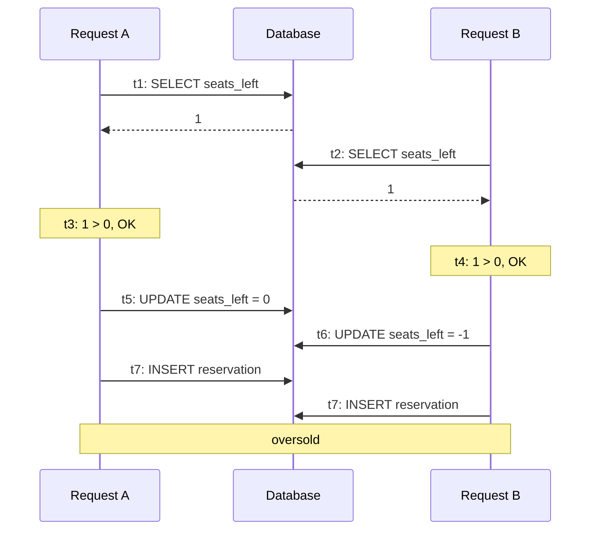

## Why this matters

Your ERP has a meeting room booking feature. It has worked for a year. Then a large customer runs a training event: 400 employees try to book 40 seats the moment registration opens. Afterwards, 52 people have confirmation emails. Twelve of them show up to find no chair.

Nothing crashed. No errors were logged. Every request "succeeded". The bug is a **race condition**: two requests read the same state, both decide they are allowed to proceed, and both write. With one user at a time it never happens. Under load it is guaranteed.

Live auctions, seat reservations, inventory decrements, coupon redemptions, invoice numbering and account balances all share this shape. This lesson teaches you to see it and fix it correctly.

## Anatomy of a race condition

The classic bug is **read-modify-write** done in application code:

```ts
// BROKEN under concurrency
async function reserveSeat(eventId: string, userId: string) {
  const event = await db.query(`SELECT seats_left FROM events WHERE id = $1`, [eventId]);
  if (event.rows[0].seats_left <= 0) throw new Error("Sold out");

  await db.query(`UPDATE events SET seats_left = seats_left - 1 WHERE id = $1`, [eventId]);
  await db.query(`INSERT INTO reservations (event_id, user_id) VALUES ($1, $2)`, [eventId, userId]);
}
```

Timeline with one seat left:



The gap between the check (t1) and the act (t5) is called a **TOCTOU** window (time of check to time of use). Every fix below either removes the gap or makes the second request notice that something changed during it.

Notice: wrapping this in a transaction at the default `READ COMMITTED` isolation level does **not** fix it. Both transactions can still read 1 before either writes.

## Fix 1: Atomic conditional updates

The simplest and often best fix: let the database do the check and the write in one statement.

```ts
async function reserveSeat(eventId: string, userId: string) {
  return db.transaction(async (tx) => {
    const res = await tx.query(
      `UPDATE events SET seats_left = seats_left - 1
       WHERE id = $1 AND seats_left > 0
       RETURNING seats_left`,
      [eventId],
    );
    if (res.rowCount === 0) throw new SoldOutError();
    await tx.query(
      `INSERT INTO reservations (event_id, user_id) VALUES ($1, $2)`,
      [eventId, userId],
    );
  });
}
```

The UPDATE takes a row lock that is held until the transaction commits or rolls back. Request B's UPDATE waits for A to finish, then re-evaluates `seats_left > 0` against the new value and matches zero rows. No oversell.

Pair it with constraints as a safety net: `CHECK (seats_left >= 0)` and `UNIQUE (event_id, user_id)` so one user cannot book twice even if your code has a bug.

## Fix 2: Pessimistic locking

**Pessimistic** locking assumes conflicts are likely, so it locks first and works second. In Postgres, `SELECT ... FOR UPDATE` locks the selected rows until the transaction ends; other transactions trying to lock them wait.

```ts
async function placeBid(auctionId: string, bidderId: string, amountCents: number) {
  return db.transaction(async (tx) => {
    const { rows } = await tx.query(
      `SELECT current_bid_cents, ends_at FROM auctions WHERE id = $1 FOR UPDATE`,
      [auctionId],
    );
    const auction = rows[0];
    if (new Date() > auction.ends_at) throw new AuctionClosedError();
    if (amountCents <= auction.current_bid_cents) throw new BidTooLowError();

    await tx.query(
      `UPDATE auctions SET current_bid_cents = $2, leader_id = $3 WHERE id = $1`,
      [auctionId, amountCents, bidderId],
    );
    await tx.query(
      `INSERT INTO bids (auction_id, bidder_id, amount_cents) VALUES ($1, $2, $3)`,
      [auctionId, bidderId, amountCents],
    );
  });
}
```

Use it when the logic between read and write is more complex than a single UPDATE can express. Costs:

- Requests for the same row are **serialized**. A hot auction receiving 500 bids/s can only process as fast as one transaction at a time. Keep the locked section tiny: no HTTP calls, no PDF rendering, no emails inside the transaction.
- **Deadlocks** if two transactions lock rows in different orders. Always lock in a consistent order (for example, by ID ascending).
- `FOR UPDATE NOWAIT` fails immediately instead of waiting; `SKIP LOCKED` skips locked rows, which is how Postgres-based job queues hand out work.

## Fix 3: Optimistic locking

**Optimistic** locking assumes conflicts are rare. Read without locking, then when writing, verify that nobody else changed the row in the meantime, using a version column.

```ts
// invoices table has: version integer not null default 0
async function updateInvoice(id: string, patch: InvoicePatch, expectedVersion: number) {
  const res = await db.query(
    `UPDATE invoices
       SET notes = $2, due_date = $3, version = version + 1
     WHERE id = $1 AND version = $4`,
    [id, patch.notes, patch.dueDate, expectedVersion],
  );
  if (res.rowCount === 0) {
    throw new ConflictError("Invoice was modified by someone else. Reload and retry.");
  }
}
```

The API returns `409 Conflict`, and the UI tells the user to refresh. HTTP even has a standard for this: send the version as an `ETag`, require `If-Match` on updates, and return `412 Precondition Failed` on mismatch.

| | Pessimistic | Optimistic |
| --- | --- | --- |
| Assumes | Conflicts are common | Conflicts are rare |
| Mechanism | Lock rows before reading (`FOR UPDATE`) | Version check on write |
| Under low contention | Small overhead from locks | Near zero overhead |
| Under high contention | Requests queue up and wait | Many requests fail and must retry |
| Typical use | Bids, seat counts, balances | Editing invoices, customer records, settings |

Rule of thumb: optimistic for human-edited records (two accountants editing the same invoice is rare), pessimistic or atomic updates for hot counters and contested resources.

## Distributed locks

Database locks protect database rows. Sometimes you need to protect something else: "only one worker may run the nightly billing job", "only one process may regenerate this tenant's search index", "only one request may call the slow external API for this key". When multiple processes on multiple machines need mutual exclusion, you need a **distributed lock**, commonly built on Redis.

```ts
import { randomUUID } from "node:crypto";

async function withLock<T>(key: string, ttlMs: number, fn: () => Promise<T>): Promise<T | null> {
  const token = randomUUID();
  const ok = await redis.set(`lock:${key}`, token, "PX", ttlMs, "NX");
  if (!ok) return null; // someone else holds it

  try {
    return await fn();
  } finally {
    // Release only if we still own it (compare-and-delete must be atomic -> Lua)
    await redis.eval(
      `if redis.call("get", KEYS[1]) == ARGV[1] then return redis.call("del", KEYS[1]) else return 0 end`,
      1,
      `lock:${key}`,
      token,
    );
  }
}
```

Why the token and the Lua script? Without them: process A takes the lock, pauses for a long garbage collection, the TTL expires, process B takes the lock, A wakes up and deletes B's lock. Now C can enter too.

Important caveat: a Redis lock with a TTL is **not** a correctness guarantee. If A pauses longer than the TTL, A and B both believe they hold the lock. For efficiency (avoid duplicate work) that is acceptable. For correctness (never double-charge), back it up with something the database enforces: a unique constraint, a version check, or a **fencing token** (a number that increases with each lock grant, which the storage layer checks to reject writes from older holders). Martin Kleppmann's essay "How to do distributed locking" is the classic read on this.

## Rate limiting

Rate limiting protects your system from overload, abuse and noisy neighbors: one tenant's runaway integration script should not degrade everyone else.

Common algorithms:

| Algorithm | Behavior | Notes |
| --- | --- | --- |
| Fixed window | Count requests per calendar minute | Simple; allows 2x burst across a window boundary |
| Sliding window log | Store a timestamp per request, count those in the last 60 s | Accurate; memory grows with limit |
| Sliding window counter | Weighted blend of current and previous window | Good accuracy, cheap |
| Token bucket | Tokens refill at a steady rate; each request spends one | Allows controlled bursts; most common in APIs |

A sliding-window limiter with a Redis sorted set, per tenant:

```ts
async function allowRequest(tenantId: string, limit = 100, windowMs = 60_000): Promise<boolean> {
  const key = `ratelimit:${tenantId}`;
  const now = Date.now();
  const results = await redis
    .multi()
    .zremrangebyscore(key, 0, now - windowMs)       // drop entries older than the window
    .zadd(key, now, `${now}:${randomUUID()}`)       // record this request
    .zcard(key)                                     // count requests in window
    .pexpire(key, windowMs)
    .exec();
  const count = results?.[2]?.[1] as number;
  return count <= limit;
}
```

When the limit is exceeded, return `429 Too Many Requests` with a `Retry-After` header. Limit by the right identity: per tenant and per API key for B2B SaaS, per IP for unauthenticated endpoints like login.

## CAP in plain language

When data is copied across multiple machines and the network between them breaks (a **partition**), each machine has to choose:

- **Consistency (C):** refuse to answer (or block) rather than return possibly stale data.
- **Availability (A):** answer anyway, with whatever data it has, even if it might be stale or conflict later.

You cannot have both during a partition. That is the CAP theorem. The "P" is not optional, because networks do fail, so the real choice is C or A **when things break**.

Concrete SaaS examples:

- **Seat reservation, payments, stock for checkout:** choose consistency. Better to show "temporarily unavailable" than to sell the same seat twice.
- **Product catalog, activity feeds, "users online" counters, analytics dashboards:** choose availability. Slightly stale is fine.

A related idea, sometimes called PACELC: even when there is no partition, you trade **latency vs consistency**. Reading from an async replica is fast but may be stale; reading from the primary is consistent but adds load and maybe latency. You make that trade every time you route a query to a replica.

The practical takeaway: for each piece of data, decide explicitly whether it needs to be strongly consistent, and keep the strongly consistent parts in one place (usually your primary Postgres) with the constraints and locks above.

## Common mistakes

- **Check-then-act in application code.** If you read a value, decide in JavaScript and then write, assume it is broken under concurrency until proven otherwise.
- **Believing a transaction alone fixes races.** At READ COMMITTED it does not. You need row locks, atomic conditional updates, or SERIALIZABLE isolation with retries.
- **Long transactions holding locks.** An HTTP call inside a `FOR UPDATE` transaction turns a 2 ms lock into a 2 s lock and throughput collapses.
- **Using a Redis lock as the only correctness guarantee for money.** Back it with database constraints.
- **Releasing a lock you no longer own.** Always use a token and atomic compare-and-delete.
- **Rate limiting in process memory.** With 5 instances, your limit is 5x what you think.
- **Not testing concurrency.** Sequential tests pass forever. Write a test that fires 100 concurrent requests and asserts on the final count.

## In the real world

Ticketing platforms, auction sites and flash-sale e-commerce are where these patterns get stress-tested. A common production design for a very hot item: keep the authoritative count in Postgres with atomic updates, put a Redis counter (using atomic DECR) in front as a fast gatekeeper that rejects requests once stock is clearly gone, and push confirmed reservations through a queue to do the slow work (payment, email). Stripe, GitHub and most public APIs expose rate limits through headers like `X-RateLimit-Remaining` and return 429s. And almost every mature SaaS has an "optimistic locking" story where two support agents overwrote each other's edits until someone added a version column.

## Try it

1. Implement the broken `reserveSeat` against a local Postgres with `seats_left = 10`. Fire 200 concurrent calls with `Promise.all`. Count reservations. You will likely see more than 10.
2. Fix it with the atomic conditional update. Rerun. Exactly 10.
3. Implement the bid endpoint with `FOR UPDATE`, then with optimistic locking. Fire 500 concurrent bids at one auction and compare successful bids, 409s and total time.
4. Add the Redis rate limiter and verify with a loop that request 101 within a minute gets a 429.
5. Draw a sequence diagram on the whiteboard showing two concurrent bids, where the lock is acquired, and where the second request waits.
