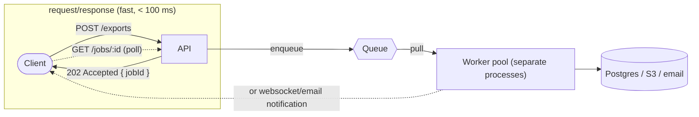
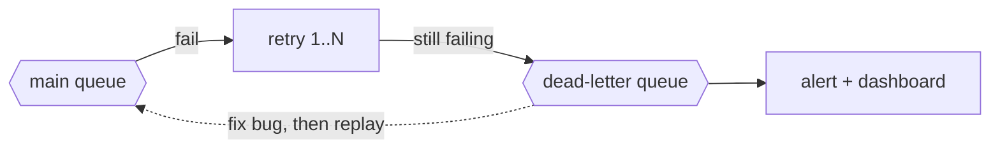

## Why this matters

A user clicks "Export year-end ledger" in your ERP. The request handler queries 400,000 rows, renders a 900-page PDF and uploads it. It takes 45 seconds. Meanwhile:

- The browser shows a spinner, and the load balancer kills the connection at 30 seconds. The user clicks again. Now two exports are running.
- The Node process is pinned at 100% CPU rendering the PDF, so every other request on that instance (including logins) stalls.
- At month-end, 300 companies export at once. Every API instance is busy rendering PDFs. The app is effectively down.

The fix is to stop doing slow work inside the request. Accept the job, put it in a queue, return immediately, and let a separate pool of workers process it at a controlled pace. This is one of the most important patterns in backend engineering, and it is what turns a fragile app into one that absorbs spikes.

## The core idea: decoupling

A **message queue** is a buffer between something that produces work and something that consumes it.



What this buys you:

- **Fast responses.** The API does a cheap insert and returns.
- **Load leveling.** 10,000 jobs arrive in a minute; workers chew through them at 200/minute. The queue absorbs the spike instead of your servers.
- **Isolation.** A slow PDF renderer cannot starve the login endpoint, because they run in different processes (ideally different machines).
- **Independent scaling.** Need more throughput? Add workers. The API does not change.
- **Retries.** If the email provider is down, the job waits and tries again instead of failing the user's request.

What it costs: more infrastructure, eventual (not immediate) results, and a whole new class of failure modes around duplicates and ordering. The rest of this lesson is about handling those.

## The 202 Accepted pattern

HTTP has a status code for exactly this: **202 Accepted** means "I received your request and will process it, but it is not done yet."

```ts
// POST /api/exports
app.post("/api/exports", async (req, res) => {
  const { tenantId, userId } = req.auth;
  const { year } = req.body;

  const job = await exportQueue.add(
    "ledger-export",
    { tenantId, userId, year },
    // dedupe key; BullMQ rejects custom IDs containing ":" (and purely numeric IDs), so use "-"
    { jobId: `ledger-${tenantId}-${year}-${req.body.requestId}` },
  );

  res.status(202)
    .location(`/api/jobs/${job.id}`)
    .json({ jobId: job.id, status: "queued" });
});

// GET /api/jobs/:id
app.get("/api/jobs/:id", async (req, res) => {
  const job = await exportQueue.getJob(req.params.id);
  if (!job || job.data.tenantId !== req.auth.tenantId) return res.sendStatus(404);
  const state = await job.getState(); // waiting | active | completed | failed | delayed
  res.json({ status: state, progress: job.progress, result: job.returnvalue ?? null });
});
```

The client then either polls `GET /api/jobs/:id` every few seconds, subscribes to a websocket/SSE channel, or gets an email with a download link. Polling is simplest and perfectly fine at moderate scale.

Note the tenant check on the job lookup. Job IDs are guessable more often than you think.

## Delivery guarantees

When a worker pulls a job, three outcomes are possible: it succeeds, it fails with an error, or it **crashes halfway** (process killed, machine dies, deploy restarts it). How the queue handles the third case defines its delivery guarantee.

| Guarantee | Meaning | Reality |
| --- | --- | --- |
| At-most-once | Delivered zero or one times; may be lost | Fire-and-forget. Fine for metrics, bad for invoices. |
| At-least-once | Never lost, but may be delivered more than once | What BullMQ, SQS, RabbitMQ (with acks) and most real queues give you. |
| Exactly-once | Delivered exactly one time | Not achievable end-to-end across networks. You simulate it with at-least-once plus idempotency. |

Why duplicates happen with at-least-once: the worker sends the email, then crashes before telling the queue "done". The queue sees the job's lock expire, assumes the worker died, and hands the job to another worker. The email goes out twice.

**You must design every job handler to be safe to run more than once.** This property is called idempotency.

## Idempotency

An operation is **idempotent** if running it twice has the same effect as running it once. `SET status = 'paid'` is idempotent. `UPDATE balance = balance - 100` is not.

Techniques, from simplest to most robust:

### 1. Natural idempotency

Write handlers as "make it so" rather than "do this":

```ts
// Not idempotent: second run uploads a duplicate file with a new name
await s3.put(`exports/${randomUUID()}.pdf`, pdf);

// Idempotent: second run overwrites the same key with the same content
await s3.put(`exports/${tenantId}/ledger-${year}.pdf`, pdf);
```

### 2. Idempotency keys with a unique constraint

Record that the side effect happened, inside the same transaction as the business change:

```ts
async function handleChargeSubscription(job: Job<{ invoiceId: string }>) {
  const { invoiceId } = job.data;
  await db.transaction(async (tx) => {
    // processed_jobs has a UNIQUE constraint on (job_key)
    const inserted = await tx.query(
      `INSERT INTO processed_jobs (job_key) VALUES ($1)
       ON CONFLICT (job_key) DO NOTHING RETURNING job_key`,
      [`charge:${invoiceId}`],
    );
    if (inserted.rowCount === 0) return; // already done, skip

    await tx.query(`UPDATE invoices SET status = 'paid' WHERE id = $1`, [invoiceId]);
  });
}
```

### 3. Pass idempotency keys to third parties

Stripe, most payment providers and many email APIs accept an `Idempotency-Key` header. Send a stable key derived from the job (for example `charge:${invoiceId}`), and the provider deduplicates retries for you.

### 4. Dedupe at enqueue

BullMQ ignores `add` calls whose `jobId` already exists. Using a deterministic job ID (`ledger-${tenantId}-${year}`) stops the double-click problem at the door. The protection lasts only while that job is still stored: once `removeOnComplete` or `removeOnFail` deletes it, the same ID can be enqueued again. Recent BullMQ versions also offer a `deduplication` option with its own TTL; either way, the handler must still be idempotent.

## Retries and backoff

Jobs fail for two kinds of reasons:

- **Transient:** network timeout, 503 from the email provider, database deadlock. Retrying later will probably work.
- **Permanent:** invalid data, deleted customer, a bug. Retrying will never work.

Retry transient failures with **exponential backoff**: wait 1 s, 2 s, 4 s, 8 s... so you do not hammer a struggling dependency. Add **jitter** (randomness) so 5,000 failed jobs do not all retry at the same instant and re-create the outage.

```ts
await emailQueue.add("send-invoice", payload, {
  attempts: 6,
  backoff: { type: "exponential", delay: 2000 }, // 2s, 4s, 8s, 16s, 32s
  removeOnComplete: { age: 3600, count: 10000 },
  removeOnFail: false, // keep failures for inspection
});
```

For permanent failures, do not burn retries. BullMQ lets you throw an `UnrecoverableError` to fail immediately.

## Dead-letter queues

A job that has exhausted all its retries needs somewhere to go other than silently disappearing. That place is a **dead-letter queue (DLQ)**: a holding area for failed jobs that a human (or alert) must look at.



In SQS and RabbitMQ the DLQ is a separate queue you configure. In BullMQ, the "failed" set plays this role: jobs stay there with their error and stack trace until you retry or remove them. Either way, the rules are:

- Alert when the DLQ is non-empty or growing.
- Keep enough context in the job payload to understand what failed.
- Have a replay mechanism so that after you fix the bug, you can reprocess the failed jobs (which must be idempotent, because some may have partially succeeded).

## A complete BullMQ example

BullMQ is the standard Redis-backed job queue for Node. Producer and worker run in separate processes.

```ts
// queue.ts (shared)
import { Queue } from "bullmq";
import IORedis from "ioredis";

export const connection = new IORedis(process.env.REDIS_URL!, {
  maxRetriesPerRequest: null, // required by BullMQ workers
});

export type PdfJob = { tenantId: string; invoiceId: string; requestedBy: string };

export const pdfQueue = new Queue<PdfJob>("invoice-pdf", {
  connection,
  defaultJobOptions: {
    attempts: 5,
    backoff: { type: "exponential", delay: 1000 },
    removeOnComplete: { age: 24 * 3600 },
    removeOnFail: false,
  },
});
```

```ts
// worker.ts (run with: node dist/worker.js, scaled independently)
import { Worker, UnrecoverableError, Job } from "bullmq";
import { connection, PdfJob } from "./queue";

const worker = new Worker<PdfJob>(
  "invoice-pdf",
  async (job: Job<PdfJob>) => {
    const { tenantId, invoiceId } = job.data;
    const invoice = await db.invoices.find(tenantId, invoiceId);
    if (!invoice) throw new UnrecoverableError(`invoice ${invoiceId} not found`);

    await job.updateProgress(10);
    const pdf = await renderInvoicePdf(invoice);   // CPU heavy
    await job.updateProgress(80);

    const key = `tenants/${tenantId}/invoices/${invoiceId}.pdf`; // deterministic = idempotent
    await storage.put(key, pdf);
    await db.invoices.update(invoiceId, { pdfKey: key });
    return { key };
  },
  {
    connection,
    concurrency: 4,                       // jobs in parallel per process
    limiter: { max: 50, duration: 1000 }, // at most 50 jobs/s for the whole queue (BullMQ's limiter is global across all workers)
  },
);

worker.on("failed", (job, err) => {
  logger.error({ jobId: job?.id, attempts: job?.attemptsMade, err }, "pdf job failed");
});

process.on("SIGTERM", async () => {
  await worker.close(); // finish in-flight jobs before exiting (graceful shutdown)
  process.exit(0);
});
```

Points worth noticing:

- `concurrency` is per process. For CPU-heavy work in Node, keep it near the number of cores and scale by running more processes.
- Graceful shutdown on SIGTERM means deploys do not kill jobs mid-flight (and if they do, at-least-once delivery plus idempotency saves you).
- The worker returns a result that the status endpoint can read.

### Sizing a worker pool

Use Little's Law again. If jobs arrive at 20/s at peak and each takes 2 s, you need 40 jobs in flight to keep up. With `concurrency: 4` per process, that is 10 worker processes. If you only run 5, the queue grows by 10 jobs/s during the peak, and you need to know how long the peak lasts to decide whether a temporary backlog is acceptable. Monitor **queue depth** and **job age** (time from enqueue to start); these are your key health metrics.

## Common mistakes

- **Running workers inside the API process.** It works in development and then the CPU-heavy job starves your HTTP handlers in production.
- **Assuming exactly-once.** Every handler that sends money, email or webhooks must be idempotent.
- **Putting huge payloads in the job.** Put IDs in the job and load data in the worker. A 5 MB image in Redis per job will exhaust memory fast; upload the file to storage first and enqueue its key.
- **Retrying forever without backoff.** You turn a provider's 5-minute blip into a self-inflicted DDoS.
- **No DLQ alerting.** Failed jobs pile up silently for weeks.
- **Using a Redis instance with `allkeys-lru` eviction for queues.** Redis may evict your jobs. Queues need `noeviction`.
- **Not exposing job status.** Users click the button again because nothing told them it was working.

## In the real world

Nearly every serious SaaS runs background jobs: Sidekiq in Rails shops, Celery in Python, BullMQ or Graphile Worker in Node, SQS with Lambda on AWS. Emails, webhooks, PDF/CSV exports, image processing, data imports, search indexing and billing runs all live in queues. When teams outgrow a job queue and need an event log that many services consume independently and can replay, they reach for Kafka or Redis Streams, but that is a different tool for a different problem: event streaming rather than task distribution.

## Try it

1. Set up BullMQ with a local Redis. Create a `POST /reports` endpoint that enqueues a job and returns 202 with a job ID, and a `GET /jobs/:id` endpoint.
2. Write a worker that sleeps 5 seconds and randomly throws 30% of the time. Configure 4 attempts with exponential backoff. Watch the retries in the logs.
3. Kill the worker with `kill -9` mid-job. Restart it. Confirm the job is picked up again (at-least-once in action).
4. Make the handler write a row to a table with a unique constraint and prove that running the same job twice produces one row.
5. On the whiteboard, draw the full flow: client, API, queue, worker pool, storage, DLQ, and the polling path back to the client.
