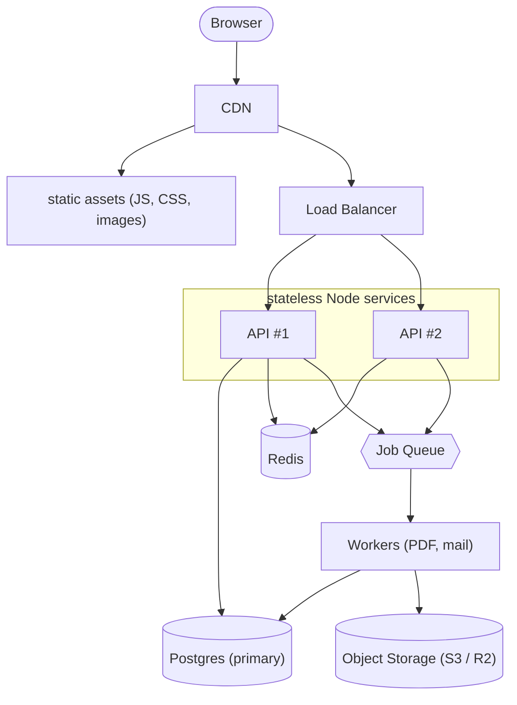

## Why this matters

You have shipped SaaS apps and ERPs. You know how to make a feature work. System design asks a different question: **will it still work when 100,000 people use it at once, when a server dies at 3 a.m., and when the data is ten times bigger than today?**

Most developers who "can't do system design" are not missing knowledge. They are missing a process. They jump straight to "use Kafka and Kubernetes" without knowing how many requests per second they need to serve, so they can't tell whether their design is overkill or hopelessly underpowered.

This lesson gives you a repeatable five-step framework. You will use it in every problem in this phase, in design reviews at work, and in interviews:

1. Clarify requirements (functional and non-functional)
2. Estimate the scale with back-of-envelope numbers
3. Draw a high-level design
4. Deep dive into the two or three hardest parts
5. Name the trade-offs and the failure modes

None of these steps is optional. The order matters because each step feeds the next.

## Step 1: Clarify requirements

Requirements come in two flavors.

**Functional requirements** are what the system does. "A user can upload an invoice." "An accountant can export the monthly ledger as a PDF." "A bidder sees the current highest bid."

**Non-functional requirements** are how well it does it. These drive almost every architecture decision:

| Non-functional requirement | Example | What it pushes you toward |
| --- | --- | --- |
| Latency | p95 under 200 ms for reads | Caching, read replicas, CDNs |
| Throughput | 5,000 requests/second at peak | Horizontal scaling, stateless services |
| Availability | 99.9% uptime (about 43 minutes down per month) | Redundancy, health checks, no single points of failure |
| Consistency | A seat can never be sold twice | Locks, transactions, a single source of truth |
| Durability | An approved invoice is never lost | Replicated databases, backups, write-ahead logs |
| Cost | Under $2,000/month in infrastructure | Simpler designs, managed services, fewer moving parts |

A useful trick: **write down what you are NOT building.** "No real-time collaborative editing. No mobile offline mode. No multi-region." Scoping things out is as important as scoping them in, and it gives you permission to keep the design simple.

### Questions to ask

- Who are the users and how many? Daily active users (DAU) vs. total registered users is a huge difference.
- What is the read/write ratio? An ERP dashboard is read-heavy (maybe 50:1). An IoT ingestion pipeline is write-heavy.
- How spiky is traffic? Payroll runs on the 25th. Black Friday. A live auction ending.
- What happens if data is briefly stale? Fine for a product catalog, unacceptable for a bank balance.
- What happens if the system is down for 5 minutes? Annoying, or legally expensive?

## Step 2: Back-of-envelope estimation

Estimation turns "lots of users" into numbers you can design against. You are not aiming for precision. You are aiming for the right **order of magnitude**: is this 10 requests per second or 10,000? The answer changes the design completely.

### Numbers worth memorizing

| Quantity | Rough value |
| --- | --- |
| Seconds in a day | 86,400 (round to 100,000) |
| Seconds in a month | about 2.6 million |
| Redis GET over local network | 0.2–1 ms |
| Postgres indexed lookup | 1–5 ms |
| Postgres query with a bad plan on a large table | 100 ms to seconds |
| Round trip within one cloud region | about 0.5 ms |
| Round trip US East to Europe | about 80 ms |
| A single Node.js process, simple JSON API | 1,000–5,000 req/s (CPU-bound work drops this hard) |
| A single Postgres instance, simple indexed queries | a few thousand to 10,000+ queries/s |
| A single Redis instance | 50,000–100,000+ ops/s |
| Default Postgres max_connections | 100 |

### Worked example: a multi-tenant invoicing SaaS

Requirements: 100,000 registered users across 2,000 companies. 20% are active on a given day. Each active user views about 30 pages and creates about 5 invoices per day. Each invoice is roughly 2 KB of row data plus a 150 KB PDF.

**Daily active users:** 100,000 x 0.2 = 20,000 DAU.

**Read requests per day:** 20,000 x 30 pages x ~3 API calls per page = 1,800,000 reads/day.

**Average read QPS (queries per second):** 1,800,000 / 100,000 seconds is about 18 req/s.

**Peak read QPS:** traffic is not flat. Business software clusters into working hours, so assume peak is about 5x average: about 90 req/s. Month-end close might double that again: about 200 req/s.

**Writes:** 20,000 x 5 = 100,000 invoices/day, about 1 write/s average, maybe 10/s peak.

**Storage per year:** 100,000 invoices/day x 365 = 36.5 million invoices/year.
- Rows: 36.5M x 2 KB is about 73 GB/year. Postgres handles this comfortably with proper indexes.
- PDFs: 36.5M x 150 KB is about 5.5 TB/year. That does **not** belong in Postgres. It belongs in object storage (S3, R2, GCS).

**Bandwidth for PDF downloads:** if each invoice PDF is downloaded twice, that is 100,000 invoices x 2 = 200,000 downloads/day x 150 KB = 30 GB/day of egress. Serve them via signed URLs from object storage or a CDN, not through your Node process.

Notice what the numbers told you:

- 200 req/s peak is **easy** for a couple of Node instances and one Postgres. You do not need microservices.
- The real scaling problem is the 5.5 TB/year of files and generating PDFs (CPU-heavy). That is where your deep dive goes.

That is the entire point of estimation: it tells you where to spend your design effort.

### Little's Law: the one formula you need

**Concurrent requests in flight = arrival rate x time each request takes.**

If you receive 1,000 req/s and each takes 200 ms, you have 1,000 x 0.2 = 200 requests in flight at any moment. If each request holds a database connection for the full 200 ms, you need about 200 connections. Default Postgres allows 100. You have found a bottleneck before writing a line of code.

## Step 3: High-level design

Now draw boxes and arrows. Start with the simplest thing that meets the requirements, then add components only when a number or requirement forces you to.



For each box, you should be able to answer: **what is it for, and what happens if it dies?**

### Data model and API sketch

Include the core entities and the main endpoints. Not every column, just enough to show you thought about access patterns.

```ts
// Core entities (sketch)
type Invoice = {
  id: string;          // uuid
  tenantId: string;    // every query filters by this -> index (tenant_id, created_at)
  customerId: string;
  status: "draft" | "sent" | "paid";
  totalCents: number;
  pdfKey: string | null; // object storage key, generated async
  createdAt: Date;
};

// Main API
// POST /invoices                 -> 201 Created
// GET  /invoices?cursor=...      -> paginated list (cursor, not OFFSET)
// POST /invoices/:id/pdf         -> 202 Accepted { jobId }
// GET  /jobs/:jobId              -> { status, downloadUrl? }
```

## Step 4: Deep dives

Pick the two or three parts that are actually hard, as revealed by your estimates. For the invoicing SaaS:

- **PDF generation:** CPU-heavy, 100,000/day, spiky at month end. Move it to a queue with a worker pool (lesson: message queues). How many workers? If one PDF takes 2 s of CPU and peak is 20 PDFs/s, you need 40 worker-seconds per second, so about 40 concurrent worker slots, or fewer if you accept a backlog that drains in minutes.
- **Dashboard reads:** the "revenue this month" widget runs an aggregate on every page load. Cache it per tenant with a short TTL (lesson: caching).
- **Multi-tenancy isolation:** one tenant with 10x the data must not slow down everyone else. Per-tenant rate limits, tenant-scoped indexes, maybe a separate queue for big tenants.

A deep dive should include: the specific mechanism, the numbers that justify it, and how it fails.

## Step 5: Trade-offs and failure modes

Every design decision is a trade. Make yours explicit:

| Decision | You gain | You pay |
| --- | --- | --- |
| Cache the dashboard for 60 s | 95% fewer aggregate queries | Numbers can be up to 60 s stale |
| Async PDF generation | Fast API, absorbs spikes | More moving parts, client must poll or get notified |
| Read replicas | Scale reads cheaply | Replication lag: user may not see their own write |
| Single Postgres primary | Simple, strongly consistent | Write throughput ceiling, single point of failure without failover |

Then walk the failure modes: "Redis goes down: we fall back to the database, which can handle the load for a while because the cache only saves us about 150 req/s. The queue goes down: PDF requests return 503 and the UI says 'try again shortly'; invoices themselves still save."

## Putting it together: the one-page template

Use this structure for every DESIGN.md you write in this phase:

```
1. Requirements
   - Functional (3-6 bullets)
   - Non-functional (latency, throughput, availability, consistency targets)
   - Out of scope
2. Estimations
   - DAU, read QPS (avg/peak), write QPS, storage/year, bandwidth
3. High-level design
   - Diagram + one sentence per component
   - Data model + key API endpoints
4. Deep dives (2-3)
5. Trade-offs and failure modes
6. What I would do at 10x scale
```

## Common mistakes

- **Designing for Google scale on day one.** If estimates say 50 req/s, a single well-indexed Postgres and two app instances is the correct answer. Adding Kafka is not a sign of seniority; justifying not adding it is.
- **Skipping estimation.** Without numbers, you cannot tell which part is the bottleneck, so you optimize the wrong thing.
- **Using averages instead of peaks.** Systems fall over at peak. Always multiply.
- **Forgetting storage growth.** 73 GB this year is fine. 73 GB/year compounded with 3x user growth for 4 years is a different conversation about partitioning and archiving.
- **Boxes with no purpose.** Every component must map to a requirement. If you can't say why a box exists, delete it.
- **Ignoring failure.** A design that only works when everything is healthy is a demo, not a system.

## In the real world

Senior engineers at SaaS companies write design docs (often called RFCs or ADRs) before building anything that touches more than one service. They look almost exactly like the template above. The review meeting is mostly people poking at the estimates and the failure modes: "What happens when the email provider is down for an hour?" "Your 5x peak factor seems low for payroll day."

At smaller companies, the same thinking happens on a whiteboard in 20 minutes. The skill is the same: numbers first, simple design, deliberate trade-offs.

## Try it

Open the whiteboard and apply the full framework to this prompt: **"A time-tracking feature for your ERP. 30,000 employees across 400 companies clock in and out. Managers view weekly timesheets. Payroll export runs every two weeks."**

1. Write five functional and four non-functional requirements. List two things out of scope.
2. Estimate: clock-in requests per second at 9:00 a.m. (assume 60% of employees clock in within a 15-minute window), storage per year, and the size of a payroll export for the biggest company (assume 2,000 employees).
3. Draw the high-level design.
4. Pick the hardest part (hint: the 9:00 a.m. spike, or the payroll export) and deep dive.
5. Write three trade-offs in the table format above.

For step 2, check your work: 30,000 x 0.6 = 18,000 clock-ins in 900 seconds is 20 req/s average across the window, with a sharp peak at 8:59–9:01 that could be 5–10x higher. That still fits one Postgres. What does that tell you about where not to spend effort?
