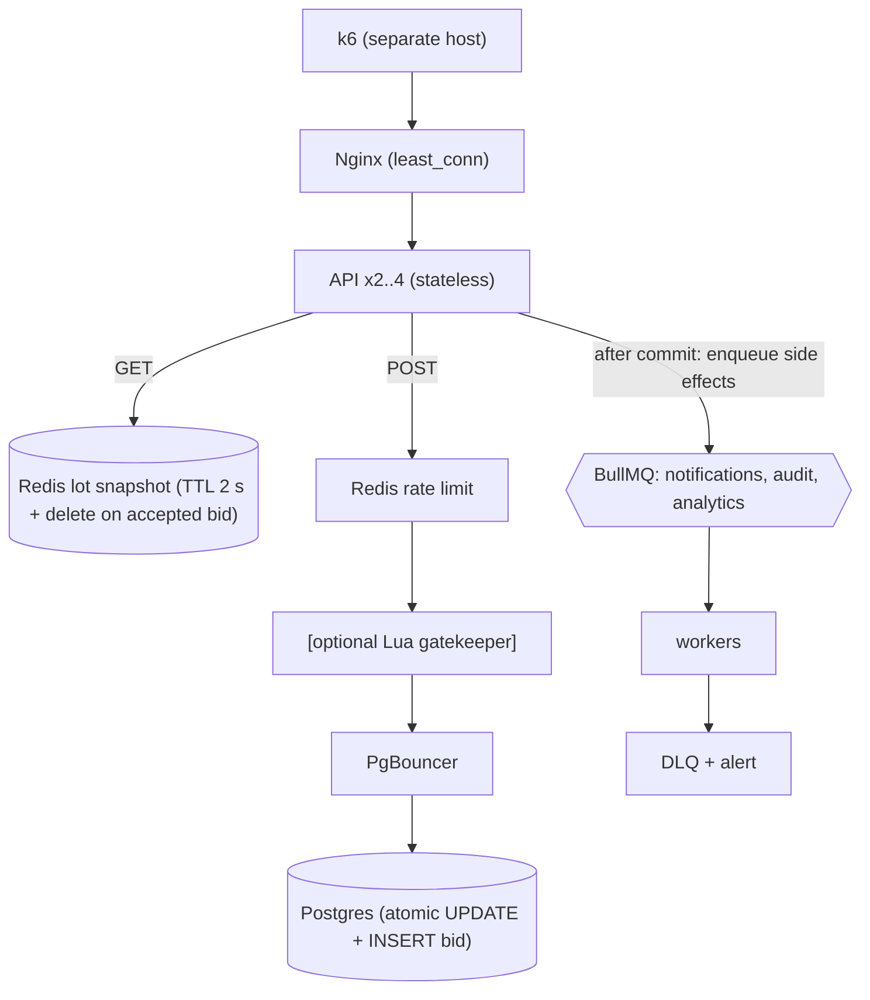

## What a strong solution looks like

A strong capstone gets correctness right first and proves it, then makes it fast and proves that too. Postgres is the only source of truth for accepted bids. The bid endpoint uses a single atomic conditional `UPDATE` (or a short `FOR UPDATE` transaction) so that a bid is accepted only if it beats the current price and the lot is still open. Redis serves lot reads, enforces rate limits and optionally rejects clearly losing bids early, but it never decides that a bid wins. Side effects run in BullMQ workers after commit.

The repo contains a concurrency test suite that fires hundreds of simultaneous bids at one lot and checks the outcome, a verifier that runs after every load test, an open-model k6 script with hot-lot skew, and a `RESULTS.md` showing several honest iterations, including the rate where the target was missed and why.

## Reference approach

### Estimation and architecture

5,000 req/s at 80/20 is 4,000 reads/s and 1,000 bids/s. The top 5 lots take 60%: 2,400 reads/s and 600 bids/s across 5 lots, about 480 reads/s and 120 bids/s per hot lot.

- **Reads:** 4,000/s from Redis is trivial for one Redis instance (50,000+ ops/s). Without the cache, 4,000 queries/s of single-row lookups is possible for Postgres but competes with bid writes.
- **Writes:** 120 bids/s on one row means 120 transactions/s serialized on that row's lock. If the locked section is about 2 ms (one `UPDATE` plus one `INSERT` in a short transaction), a row can handle roughly 500/s, so 120/s fits with headroom. If the section is 30 ms because something slow sits inside it, the ceiling drops to about 33/s and latency explodes.
- **Connections:** Little's Law: 1,000 bids/s x 5 ms = 5 connections busy on average, plus cache misses. Two to four API instances with pools of 10–15 each fit easily under `max_connections = 100`; put PgBouncer in front anyway so scaling instances does not change the math.



### The write path

```sql
-- inside one short transaction
UPDATE lots
   SET current_price_cents = $2, leader_id = $3, version = version + 1
 WHERE id = $1
   AND ends_at > now()
   AND $2 >= current_price_cents + min_increment_cents
RETURNING version;
-- if 1 row: INSERT INTO bids (lot_id, bidder_id, amount_cents, lot_version) VALUES (...)
-- if 0 rows: rollback, respond 409 (outbid or closed)
```

`bids` has `UNIQUE (lot_id, lot_version)`, so two accepted bids can never claim the same position, and a `CHECK (amount_cents > 0)`. Because the `UPDATE` re-checks the price after waiting for the row lock, Postgres serializes competing bids correctly at `READ COMMITTED`.

After commit, enqueue the outbid notification with `jobId: "outbid-" + lotId + "-" + version`, so a retried enqueue does not create a second notification. For stronger guarantees, write an outbox row in the same transaction and have a relay enqueue it; otherwise a crash between commit and enqueue loses one notification, and you should say so.

### The read path and Redis flush

Cache `lot:{id}:v1` as a small JSON snapshot with a short TTL (1–2 s) and delete it after each accepted bid. Use single-flight with a token lock on misses: the hot lots get about 480 reads/s each, so a miss without it sends dozens of identical queries. If Redis is flushed, reads fall back to Postgres for a moment and bids are unaffected, because nothing in the bid decision depends on Redis. A Lua gatekeeper, if used, must treat a missing key as "unknown, let Postgres decide".

### Rate limiting and k6

Per-user limit in Redis (for example 5 bids per second) returning `429` with `Retry-After`. In k6, model hot lots by choosing a lot from the top 5 with probability 0.6, and declare expected statuses so business rejections are not counted as errors:

```js
http.setResponseCallback(http.expectedStatuses({ min: 200, max: 299 }, 409, 429));
```

Track 409 and 429 rates as separate counters, and add a check so a 429 rate above a few percent is visible rather than hidden.

### Concurrency tests and verifier

```ts
it("accepts only strictly increasing bids under concurrency", async () => {
  const lotId = await seedLot({ startPriceCents: 1000, minIncrementCents: 1 });
  const amounts = shuffle(Array.from({ length: 300 }, (_, i) => 1001 + i * 7));
  const results = await Promise.all(amounts.map((a, i) => placeBid(lotId, `u${i}`, a)));

  const accepted = await db.query(
    `SELECT amount_cents, bidder_id FROM bids WHERE lot_id = $1 ORDER BY lot_version`, [lotId]);
  const seq = accepted.rows.map((r) => r.amount_cents);
  for (let i = 1; i < seq.length; i++) expect(seq[i]).toBeGreaterThan(seq[i - 1]);

  const lot = await getLotFromDb(lotId);
  expect(lot.currentPriceCents).toBe(Math.max(...amounts)); // highest bid always wins
  expect(lot.leaderId).toBe(accepted.rows.at(-1).bidder_id);
  expect(results.filter((r) => r.status === 201)).toHaveLength(seq.length);
  expect(await verifyLot(lotId)).toEqual([]); // same function the post-load-test verifier uses
});
```

Repeat it after `redis.flushall()`, add a test that a bid one millisecond after `ends_at` gets 409, and test that running the outbid job twice records one notification. The verifier checks every lot: strictly increasing accepted bids by version, none created after `ends_at`, `current_price` and `leader` equal to the last accepted bid, and no duplicate `(lot_id, lot_version)`.

### What usually moves the numbers

A typical progression: cache lot reads (Postgres CPU drops, read p95 to single-digit ms); move audit inserts out of the transaction (lock time and bid p95 drop); then API CPU or the k6 host becomes the limit.

## Common mistakes

- **Redis as the decision maker.** A Lua script that accepts bids and "syncs to Postgres later" fails the flush test and the durability requirement.
- **Check-then-act in JavaScript**: `SELECT` price, compare, `UPDATE`. Passes sequential tests, fails the first concurrent one.
- **Counting 409s as errors** (or worse, excluding all 4xx and missing real failures).
- **Closed-model load tests** that report VUs instead of an achieved arrival rate.
- **Uniform lot selection**, which hides hot-row contention entirely.
- **Side effects inside the transaction**, which turn a 2 ms lock into a 50 ms lock.
- **Verifier written after the load test**, so the first runs were never checked.

## Trade-offs worth discussing

- **Atomic UPDATE vs `FOR UPDATE` vs optimistic versioning.** Atomic update is shortest; `FOR UPDATE` allows richer rules (proxy bidding, anti-sniping) at the cost of a longer lock; optimistic versioning makes most bids on a hot lot fail and retry, which is wasteful at 120 bids/s per row.
- **Redis gatekeeper.** It sheds losing bids before they touch Postgres, but adds a second place where state lives and a consistency story to explain.
- **Cache TTL for lot reads.** 2 s of staleness on the displayed price is usually acceptable because the bid path re-checks. Pushing updates via SSE removes polling load but adds connection management.
- **Outbox vs enqueue after commit.** Outbox gives no lost side effects at the cost of a relay and an extra write per bid.

## Grade yourself

| Dimension | Strong | Acceptable | Needs work |
| --- | --- | --- | --- |
| Bid correctness | Atomic DB-enforced rule, unique constraints, concurrency tests and verifier pass after every run including Redis flush | Correct approach, verifier only | Check-then-act or Redis as source of truth |
| Automated tests | `npm test` with 200+ concurrent bids, flush test, closed-lot test, idempotent side-effect test | Concurrency test only | No automated tests |
| Load test realism | Open model, 80/20 mix, hot-lot skew, separate load generator, 409/429 handled as expected | Open model, uniform keys | Closed model or single key |
| Results and iteration | Three or more iterations with evidence for each bottleneck, honest maximum rate | Iterations without evidence | One headline number |
| Architecture | Stateless instances, pool math shown, side effects queued with DLQ, diagrams before and after | Most pieces present | Single instance or synchronous side effects |

## Going further

1. Add anti-sniping (extend `ends_at` on late bids) inside the same atomic statement, and extend the verifier to check it.
2. Push price updates over SSE with Redis pub/sub and load test 10,000 open connections.
