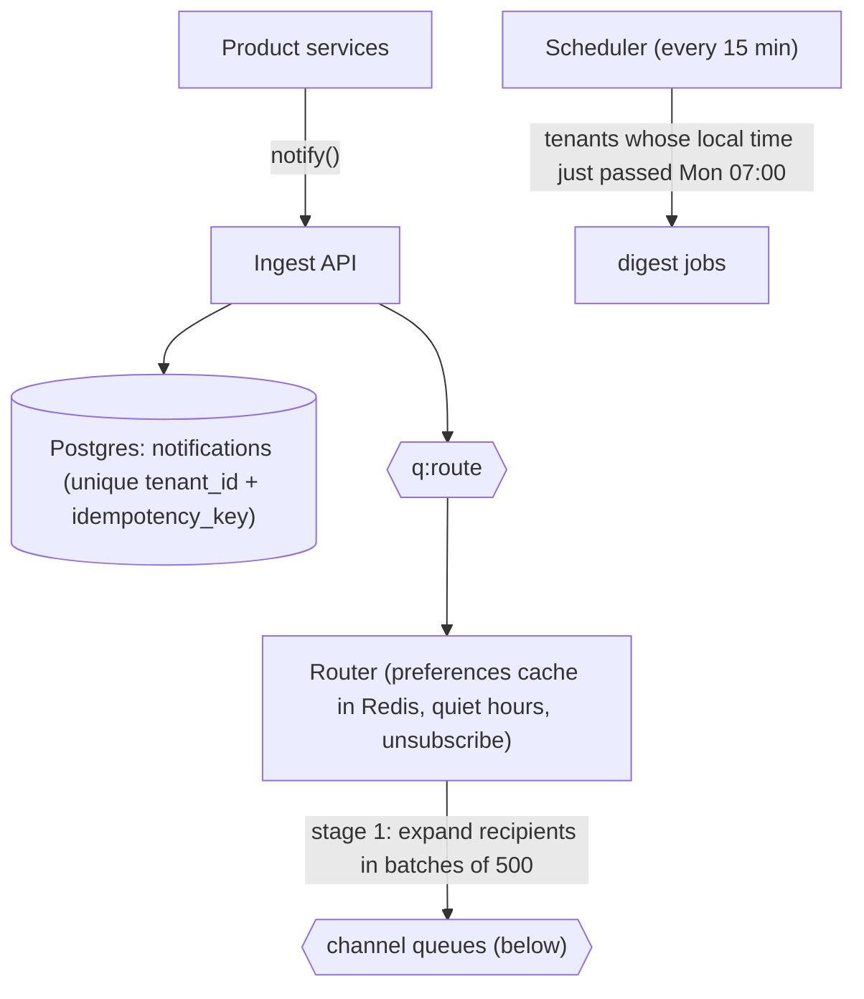
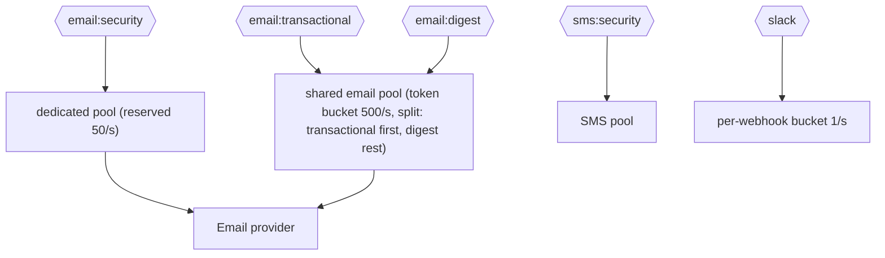
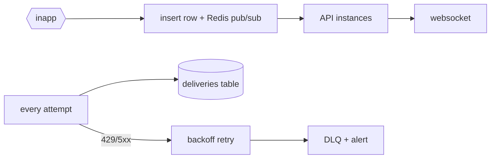

## What a strong solution looks like

A strong design has one entry point, `notify()`, that persists the notification with an idempotency key before anything else happens, so nothing is lost and nothing is created twice. A routing step applies preferences, quiet hours and unsubscribe rules, then fans out in two stages into per-channel, per-priority queues. Security notifications have their own queue, their own workers and reserved provider capacity, so the Monday digest physically cannot sit in front of a password reset. Each channel's workers enforce token buckets for the provider and for each webhook, and every attempt is written to a `deliveries` table that support can query.

The estimates answer the brief's key question directly: 500 emails/second is enough, with arithmetic, and the design shows how capacity is divided between priorities.

## Reference approach

### Diagram in words







### Estimations

**Transactional.** 1.5M/day, about 80% in a 10-hour business window: 1.2M / 36,000 s is about 33/s, peaking at 5x, about 170/s. Each goes to in-app and usually email, so roughly 170 emails/s and 170 in-app inserts/s at peak.

**Security.** SMS 20,000/day is under 1/s on average; password resets and 2FA emails are a similar order. Reserve 50/s of email capacity for security, far above need, so they never wait for a token.

**Monday digest.** 250,000 at 07:00 local. Timezones spread it, but assume the worst case: 60% of users in one timezone, 150,000 at once. Email budget after reserving 50/s for security and 170/s for peak transactional: 500 - 220 = 280/s. 150,000 / 280 is about 540 s, about 9 minutes. The 2-hour target allows a rate of only 150,000 / 7,200 = 21/s. Conclusion: 500/s is enough, and the digest can be deliberately throttled to, say, 100/s, finishing in 25 minutes while leaving plenty of headroom for transactional spikes.

**30,000-user announcement.** Stage 1 creates 60 batch jobs of 500 recipients. In-app: 30,000 inserts in 60 multi-row inserts, done in seconds. Email at the transactional lane's leftover rate, or a dedicated "bulk" rate of 100/s: 300 s, 5 minutes. A per-tenant cap (for example 100 emails/s per tenant) means one tenant's announcement cannot consume the whole transactional budget.

**Slack.** About 500 tenants with webhooks. At 1 message/s per webhook, a burst of 60 notifications to one channel takes a minute; batching ("12 approvals pending") is the fix for noisy channels.

**Storage.** About 1.55M notifications/day (transactional plus digests averaged over a week). Assume 500 bytes per notification row and two delivery rows of 300 bytes each: about 1.1 KB per notification, about 1.7 GB/day, about 620 GB/year. Retain 90 days in Postgres (about 150 GB), partitioned by day or month so retention is a `DROP PARTITION`, and archive delivery logs to object storage if compliance needs longer.

### Data model and API

```ts
notify({
  tenantId, type: "invoice.approved", priority: "transactional",
  recipients: { userIds: ["u1", "u2"] },  // or { role: "approvers" }
  data: { invoiceId: "inv_4021" },
  idempotencyKey: "invoice.approved:inv_4021",
}): Promise<{ notificationId: string; deduplicated: boolean }>;
```

```sql
CREATE TABLE notifications (
  id uuid PRIMARY KEY, tenant_id uuid NOT NULL, type text NOT NULL,
  priority text NOT NULL, data jsonb NOT NULL, idempotency_key text NOT NULL,
  created_at timestamptz NOT NULL DEFAULT now(),
  UNIQUE (tenant_id, idempotency_key)
);
CREATE TABLE deliveries (
  notification_id uuid NOT NULL, user_id uuid NOT NULL, channel text NOT NULL,
  status text NOT NULL, attempts int NOT NULL DEFAULT 0,
  provider_message_id text, last_error text, updated_at timestamptz NOT NULL,
  PRIMARY KEY (notification_id, user_id, channel)
);
```

Plus `user_preferences (user_id, type, channel, enabled)`, `quiet_hours` per user, and versioned `templates (tenant_id NULL for defaults, type, channel, locale, version)`.

### Deep dives

**Priority isolation.** Separate queues and worker pools per priority, plus reserved token-bucket capacity for security. A priority field on one queue fails when all workers are busy with digest jobs.

**Exactly-once appearance.** The `deliveries` primary key is the idempotency key for a delivery. A worker claims it with `UPDATE deliveries SET status = 'sending' WHERE ... AND status IN ('pending', 'retry')`; the provider call carries `notificationId:userId:channel` as its idempotency or custom-ID header where supported. A crash after the provider accepted the email but before recording it can still duplicate when the provider has no dedupe: say so, and say it is rare.

**External rate limits.** A Redis token bucket (Lua script, atomic) per provider and per webhook URL. On `429`, honor `Retry-After` and pause that bucket rather than retrying every job individually.

**Preferences and quiet hours.** Evaluated once in the router, cached in Redis per user with a 5-minute TTL and deleted on change. Security notifications bypass quiet hours and unsubscribe; digests carry a one-click unsubscribe link.

## Common mistakes

- **Priority as a number on a shared queue** instead of isolated lanes and reserved capacity.
- **Fan-out in one job** that loops over 30,000 users; one failure retries the whole announcement and duplicates emails.
- **Rate limiting per worker process** instead of a shared bucket, so 10 workers send 10x the provider limit.
- **No persistence before enqueue**, so a Redis outage silently loses notifications.
- **Treating digests and security alerts the same for unsubscribe**, which is either illegal or dangerous.
- **No delivery log**, so "did the customer get the email?" is unanswerable.

## Trade-offs worth discussing

- **Postgres outbox vs enqueue-and-hope.** Writing the notification and an outbox row in the same transaction as the business change guarantees no lost notifications, at the cost of a relay process.
- **One email provider vs two.** Failover improves availability but doubles templates, bounce handling and reputation management.
- **Evaluating preferences at send time vs at fan-out.** Send time is fresher; fan-out time is cheaper. Most teams evaluate at fan-out and accept a few minutes of staleness.
- **Redis pub/sub vs a managed realtime service** for in-app push: pub/sub is cheap but fire-and-forget, so clients must re-fetch unread counts on reconnect.

## Grade yourself

| Dimension | Strong | Acceptable | Needs work |
| --- | --- | --- | --- |
| Estimations | Per-channel avg and peak, digest burst against 500/s with headroom, announcement, storage with retention | Main numbers, digest math present | No answer to the 500/s question |
| Priority isolation | Separate lanes, pools and reserved capacity; password reset trace during Monday peak | Separate queues sharing workers | Single queue with priority field |
| Idempotency | Unique keys at ingest and per delivery, provider keys, honest about residual risk | Ingest dedupe only | Retries can duplicate freely |
| Rate limits and fairness | Shared token buckets per provider and webhook, per-tenant caps, 429 handling | Provider limit only | Per-process limits or none |
| Failure table | Five or more rows with user and tenant-admin view | Five rows, vague outcomes | Missing |
| Diagram | Every box justified, priority paths visible | Mostly consistent | Boxes without purpose |

## Going further

1. Design batching ("5 invoices need approval") with an aggregation window and show how it changes the Slack numbers.
2. Add per-tenant metering and plan-based caps, and describe what a tenant admin sees when capped.
3. Write the runbook for "email provider down for an hour": queue growth, alert thresholds and catch-up rate afterwards.
