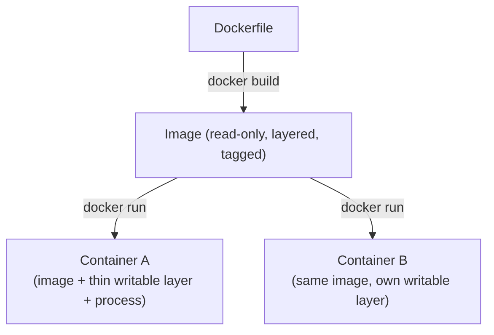
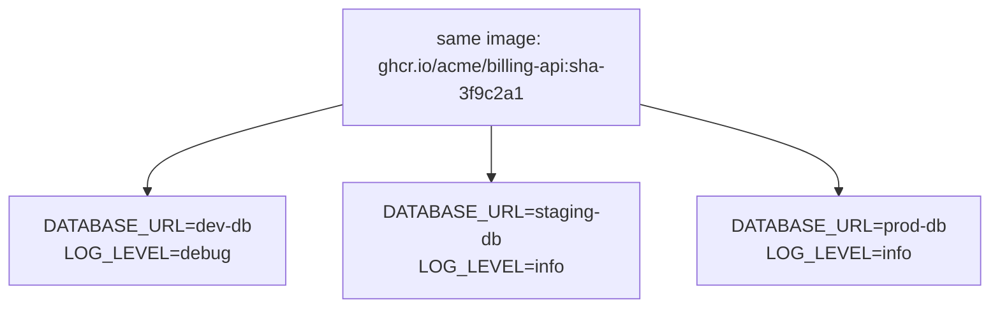

## Why this matters

The invoice PDF service works on your laptop. On the server it crashes because the server has Node 20 and you used a Node 22 API, or because `sharp` was compiled for macOS ARM and the server is Linux x86, or because someone installed a different `libssl` last month. Every deploy is an archaeology dig through the state of one specific machine.

Docker replaces "the machine as configured by hand" with an **image**: a frozen, versioned filesystem containing the exact OS libraries, runtime, dependencies and your built code. The same image runs on your laptop, in CI, on staging and in production. If it passed tests in CI, the bytes that go to production are the bytes that were tested.

## Images vs containers



- An **image** is a read-only template: a stack of filesystem layers plus metadata (default command, exposed ports, env vars, user). It has a name and tag like `ghcr.io/acme/billing-api:1.4.2`.
- A **container** is a running (or stopped) instance of an image: a process, isolated with Linux namespaces and limited with cgroups, with a thin writable layer on top.

Analogy for a TypeScript developer: an image is a class, a container is an instance. You can start fifty containers from one image.

Containers are **ephemeral**. Anything written inside the container's filesystem is lost when you remove it. Uploaded files, generated PDFs and database data must go to volumes or, better in production, to external storage (S3, a managed Postgres).

Essential commands:

```bash
docker build -t billing-api:dev .          # build an image from ./Dockerfile
docker images                               # list images
docker run --rm -p 3000:3000 billing-api:dev  # run, map host:container port, remove on exit
docker ps                                   # running containers
docker logs -f <container>                  # stream stdout/stderr
docker exec -it <container> sh              # shell inside a running container
docker stop <container>                     # SIGTERM, then SIGKILL after 10s
```

## Layers and build caching

Each instruction in a Dockerfile (`FROM`, `COPY`, `RUN`, ...) produces a layer. Docker caches layers and reuses one if the instruction and its inputs are unchanged. **Once a layer changes, every layer after it is rebuilt.**

This is the naive Dockerfile almost everyone writes first:

```dockerfile
FROM node:24
WORKDIR /app
COPY . .
RUN npm install
RUN npm run build
CMD ["npm", "start"]
```

Problems: any source change invalidates `COPY . .`, so `npm install` re-runs on every build (minutes). It ships dev dependencies, the TypeScript source, possibly your `.env`, runs as root, and the `node:24` image is around 1 GB.

Order instructions from least to most frequently changing:

```
  FROM node:24-alpine            <- changes rarely
  COPY package*.json ./          <- changes when deps change
  RUN npm ci                     <- cached unless lockfile changed
  COPY . .                       <- changes every commit
  RUN npm run build              <- reruns every commit (fast)
```

Now a code-only change reuses the cached `npm ci` layer.

## Multi-stage builds for Node

A multi-stage build uses one stage with full tooling to build, then copies only the output into a small runtime stage. The final image never contains the compiler, dev dependencies or source.

```dockerfile
# syntax=docker/dockerfile:1

############ deps: production dependencies only ############
FROM node:24-alpine AS deps
WORKDIR /app
COPY package.json package-lock.json ./
RUN npm ci --omit=dev

############ build: full deps + compile TypeScript ############
FROM node:24-alpine AS build
WORKDIR /app
COPY package.json package-lock.json ./
RUN npm ci
COPY tsconfig.json ./
COPY src ./src
RUN npm run build

############ runtime: minimal, non-root ############
FROM node:24-alpine AS runtime
ENV NODE_ENV=production
WORKDIR /app

# node:alpine images ship a non-root "node" user (uid 1000)
COPY --from=deps  --chown=node:node /app/node_modules ./node_modules
COPY --from=build --chown=node:node /app/dist ./dist
COPY --chown=node:node package.json ./

USER node
EXPOSE 3000

HEALTHCHECK --interval=15s --timeout=3s --start-period=20s --retries=3 \
  CMD wget -qO- http://127.0.0.1:3000/healthz || exit 1

CMD ["node", "dist/server.js"]
```

What each decision buys you:

| Decision | Benefit |
|---|---|
| `node:24-alpine` instead of `node:24` | Image drops from about 1 GB to around 150-200 MB; smaller attack surface |
| Pin the major version (`24`), or a digest for full reproducibility | No surprise runtime upgrade |
| `npm ci` instead of `npm install` | Installs exactly the lockfile; fails if it is out of sync |
| Separate `deps` stage with `--omit=dev` | Runtime has no TypeScript, Vitest, ESLint |
| `CMD ["node", ...]` exec form, not `npm start` | Node is PID 1 and receives SIGTERM directly for graceful shutdown (see the PID 1 note below) |
| `USER node` | A compromise of the app does not give root inside the container |

Native modules (`sharp`, `bcrypt`) compile against the libc of the stage they are installed in. Because `deps` and `runtime` both use `node:24-alpine`, the binaries match. If you mix Alpine (musl) and Debian (glibc) stages, you get crashes at runtime.

For even smaller images, Google's distroless Node images (`gcr.io/distroless/nodejs<major>-debian12`, matching your Node major) contain only Node and no shell. That is more secure but you lose `wget` for healthchecks and `sh` for debugging, so start with Alpine or `node:24-slim`.

## .dockerignore

`COPY . .` sends the whole build context to the Docker daemon. Without a `.dockerignore`, that includes `node_modules` (hundreds of MB, and the wrong platform), `.git`, and your local `.env` with real secrets, which then ends up baked into an image layer forever.

```gitignore
# .dockerignore
node_modules
dist
coverage
.git
.github
.env
.env.*
!.env.example
*.log
Dockerfile*
compose*.yaml
.vscode
```

Rule: treat `.dockerignore` like a security control, not a performance tweak. Anything copied into a layer can be extracted by anyone who can pull the image, even if a later layer deletes it.

## Configuration and secrets

Build the image once, configure it per environment at runtime. That is the twelve-factor "config in the environment" principle.



Validate config at startup so a misconfigured container fails immediately and loudly rather than at the first invoice:

```ts
// src/config.ts
import { z } from "zod";

const Env = z.object({
  NODE_ENV: z.enum(["development", "test", "production"]),
  PORT: z.coerce.number().int().default(3000),
  DATABASE_URL: z.string().url(),
  STRIPE_SECRET_KEY: z.string().startsWith("sk_"),
  LOG_LEVEL: z.enum(["debug", "info", "warn", "error"]).default("info"),
});

export const config = Env.parse(process.env); // throws with a readable message
```

Never put secrets in `ENV` or `ARG` in the Dockerfile. `ARG` values are visible in `docker history`. Pass secrets at runtime via the orchestrator's secret store, or with `--env-file` locally. If a build step truly needs a secret (a private npm token), use BuildKit secret mounts:

```dockerfile
RUN --mount=type=secret,id=npmrc,target=/root/.npmrc npm ci
```

```bash
docker build --secret id=npmrc,src=$HOME/.npmrc -t billing-api .
```

## Healthchecks and graceful shutdown

A container that is "running" is not necessarily "working". The app might be stuck, or unable to reach Postgres. Expose two endpoints:

- `/healthz` (liveness): the process is alive and the event loop responds. Cheap, no dependencies.
- `/readyz` (readiness): the app can serve traffic, for example the DB pool can run `select 1`.

```ts
app.get("/healthz", async () => ({ status: "ok" }));

app.get("/readyz", async (_req, reply) => {
  try {
    await pool.query("select 1");
    return { status: "ready" };
  } catch {
    return reply.code(503).send({ status: "db_unavailable" });
  }
});

// Graceful shutdown: stop accepting, finish in-flight requests, close pool
for (const signal of ["SIGTERM", "SIGINT"] as const) {
  process.on(signal, async () => {
    await app.close();
    await pool.end();
    process.exit(0);
  });
}
```

Orchestrators send SIGTERM, wait a grace period, then SIGKILL.

A PID 1 subtlety: the Linux kernel does not apply default signal actions to PID 1, so a Node process running as PID 1 *without* a SIGTERM handler simply ignores SIGTERM and gets SIGKILLed after the grace period. Exec-form `CMD` is necessary but not sufficient; you also need the handler above. If you cannot add one (or you spawn child processes), run with `docker run --init` (or compose `init: true`) so a tiny init process sits at PID 1, forwards signals and reaps zombies. If your app ignores SIGTERM (common when started via `npm start` or a shell script that does not forward signals), every deploy kills in-flight requests, including half-written invoice transactions.

## docker compose for local development

Compose describes a multi-container environment in one file. A typical SaaS stack locally:

```yaml
# compose.yaml
services:
  api:
    build:
      context: .
      target: build          # use the build stage; has dev deps for watch mode
    command: npm run dev
    ports:
      - "3000:3000"
    env_file: .env
    environment:
      DATABASE_URL: postgres://app:app@db:5432/app
      REDIS_URL: redis://redis:6379
    volumes:
      - ./src:/app/src       # live reload of source
    depends_on:
      db:
        condition: service_healthy
      redis:
        condition: service_started

  db:
    image: postgres:16-alpine
    environment:
      POSTGRES_USER: app
      POSTGRES_PASSWORD: app
      POSTGRES_DB: app
    ports:
      - "5432:5432"
    volumes:
      - pgdata:/var/lib/postgresql/data
    healthcheck:
      test: ["CMD-SHELL", "pg_isready -U app -d app"]
      interval: 3s
      timeout: 3s
      retries: 20

  redis:
    image: redis:7-alpine

volumes:
  pgdata:
```

Key points:

- Services reach each other by **service name** on the compose network: `db:5432`, not `localhost:5432`. Inside a container, `localhost` is the container itself.
- `depends_on` with `condition: service_healthy` waits for Postgres to accept connections, not merely for the container to start.
- Named volumes (`pgdata`) persist across `docker compose down`. `docker compose down -v` deletes them.
- Compose is excellent for local dev and simple single-host deployments. For multi-node production you would use a platform (ECS, Fly.io, Kubernetes, Render) that runs the same image.

```bash
docker compose up -d --build     # build and start in the background
docker compose logs -f api       # follow logs
docker compose exec db psql -U app   # psql into the database
docker compose down              # stop and remove containers
```

## Verifying an image is self-contained

The point of the exercise is that nothing leaks in from your host. Check:

```bash
docker build -t billing-api:check .
docker image ls billing-api:check                  # size sanity check
docker run --rm billing-api:check whoami           # should print "node", not "root"
docker run --rm billing-api:check ls /app          # dist, node_modules, package.json only
docker run --rm -e DATABASE_URL=postgres://... -p 3000:3000 billing-api:check
curl -f localhost:3000/healthz
docker inspect --format '{{.State.Health.Status}}' <container>   # healthy
```

Also try running it on a machine (or CI runner) that has never seen your project. If it needs anything you did not put in the Dockerfile, it is not self-contained.

## Common mistakes

- **`COPY . .` before `npm ci`.** Destroys caching; every build reinstalls everything.
- **No `.dockerignore`.** Ships `.env` and host `node_modules` (wrong platform binaries) into the image.
- **Running as root.** The default for most base images. Add `USER`.
- **`latest` tags everywhere.** `FROM node:latest` changes under you; deploying `myapp:latest` makes rollbacks ambiguous. Use pinned base images and immutable tags such as the git SHA.
- **`CMD npm start` or shell form.** Signals do not reach Node; graceful shutdown never runs.
- **Storing state in the container filesystem.** Uploaded files vanish on the next deploy.
- **Using `localhost` to reach another compose service.** Use the service name.
- **Baking environment-specific config into the image.** One image per environment defeats the point.

## In the real world

Teams typically build one image per commit in CI, tag it with the git SHA (`sha-3f9c2a1`), push to a registry, and promote that exact tag from staging to production. Nobody runs `docker build` on a production server. Image scanning (Trivy, Docker Scout, GitHub's Dependabot for Dockerfiles) runs in CI and flags vulnerable base images; rebuilding weekly picks up OS security patches even when your code has not changed.

A typical Node API image built this way is 150-250 MB, builds in under a minute with cache, and starts in a second or two. When teams see 1.5 GB images with ten-minute builds, the cause is nearly always a single-stage build, missing `.dockerignore`, and cache-hostile instruction ordering.

## Try it

1. Take an existing Node/TypeScript API. Write the multi-stage Dockerfile above, adapting the build output path.
2. Add a `.dockerignore`. Build twice, changing only a source file between builds. Confirm `npm ci` is reported as `CACHED` the second time.
3. Add `/healthz` and `/readyz` and a SIGTERM handler. Run the container, then `docker stop` it and confirm the shutdown log appears within a second, not after 10 seconds.
4. Write a `compose.yaml` with the API, Postgres and Redis. Confirm the API waits for Postgres to be healthy.
5. Run `docker run --rm <image> whoami` and `docker history <image>` and confirm no secrets and no root user.
