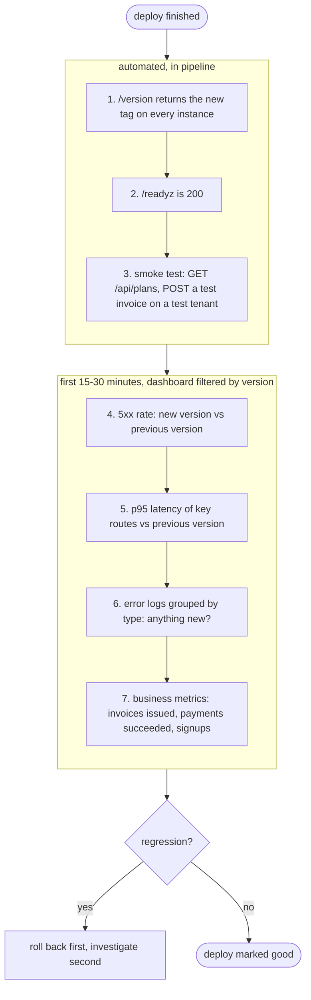

## Why this matters

The pipeline is green, the deploy finished, health checks passed. Two hours later a customer emails: "Our invoices since this morning have no VAT line." Health checks did not catch it because the process is perfectly healthy; it is just wrong. You open the server logs and find `console.log("here")`, `console.log(err)` printing `[object Object]`, and no way to tell which request belonged to which customer.

Automated testing tells you the code worked in CI. Observability tells you whether it works **in production, for real customers, right now**, and when it does not, it lets you answer "what is broken, for whom, since when, and why" in minutes rather than hours. It also closes the loop on CD: you cannot decide whether to promote a canary or roll back without signals.

## The three signals

| Signal | What it is | Good for | Example |
|---|---|---|---|
| Logs | Timestamped records of discrete events | The detail of one request or failure | `invoice.issue failed tenant=t_42 invoice=inv_9 err=TAX_PROVIDER_TIMEOUT` |
| Metrics | Numeric measurements aggregated over time | Trends, alerting, dashboards | `http_requests_total{route="/invoices",status="500"}` |
| Traces | The path of one request across services, with timing per step | Finding where latency comes from | API 1200 ms = 40 ms DB + 1100 ms tax API |

Metrics tell you *something* is wrong (error rate jumped). Logs and traces tell you *what*. Start with structured logs and a few metrics; add tracing when you have more than one service or unexplained latency.

## Structured logging

A structured log is a JSON object per line, not a sentence. Machines can filter, group and count it.

```
 unstructured:  Invoice inv_9 failed for Acme: timeout
 structured:    {"level":"error","time":"2026-03-02T10:14:03.120Z","msg":"invoice issue failed",
                 "requestId":"req_7f2","tenantId":"t_42","invoiceId":"inv_9",
                 "err":{"type":"TaxProviderTimeout","message":"timeout after 5000ms"},
                 "version":"sha-3f9c2a1"}
```

With the second form you can query "all errors for tenant t_42 in the last hour" or "count errors by version", which is exactly the question you ask after a deploy.

Use `pino`, the de facto fast JSON logger for Node (Fastify uses it built in):

```ts
// src/logger.ts
import pino from "pino";

export const logger = pino({
  level: process.env.LOG_LEVEL ?? "info",
  base: {
    service: "billing-api",
    version: process.env.APP_VERSION ?? "dev", // set to the image tag at deploy time
    env: process.env.NODE_ENV,
  },
  redact: {
    paths: ["req.headers.authorization", "req.headers.cookie", "*.password", "*.cardNumber", "*.iban"],
    censor: "[redacted]",
  },
});
```

Redaction paths are exact: `*.password` matches one level deep (`{ user: { password } }`), not `{ body: { user: { password } } }`. List the shapes you actually log, and add a unit test that logs a sample object and asserts the secret is not in the output.

Bake the version into the image so every log line says which release produced it:

```dockerfile
ARG APP_VERSION=dev
ENV APP_VERSION=$APP_VERSION
```

```yaml
      - uses: docker/build-push-action@v7
        with:
          build-args: APP_VERSION=${{ steps.vars.outputs.tag }}   # e.g. sha-3f9c2a1, same as the image tag
```

### Request context

Every log line inside a request should carry the request ID and tenant, without passing a logger through every function. Use a child logger per request; with `AsyncLocalStorage` you can reach it from anywhere:

```ts
// src/request-context.ts
import { AsyncLocalStorage } from "node:async_hooks";
import type { Logger } from "pino";
import { logger } from "./logger";

const als = new AsyncLocalStorage<{ log: Logger }>();

export function runWithContext<T>(ctx: { requestId: string; tenantId?: string }, fn: () => T): T {
  return als.run({ log: logger.child(ctx) }, fn);
}

export function log(): Logger {
  return als.getStore()?.log ?? logger;
}
```

```ts
// inside the service
log().info({ invoiceId, netCents, country }, "invoice issued");
```

Accept an incoming `x-request-id` header (from your load balancer) or generate one, and return it in the response. When a customer reports a problem, support can give you that ID.

### What and how to log

| Level | Use for | Example |
|---|---|---|
| `error` | Something failed and needs attention | Payment capture failed, unhandled exception |
| `warn` | Unexpected but handled | Retrying tax API, deprecated endpoint called |
| `info` | Business-significant events | Invoice issued, subscription upgraded, deploy started |
| `debug` | Developer detail, off in production | SQL parameters, intermediate calculations |

Rules:

- Log **events with context** ("invoice issued", with IDs), not progress narration ("entering function").
- Log errors **once**, where you handle them, with the error object (`log().error({ err }, "...")`) so the stack trace is kept.
- **Never log secrets or personal data**: passwords, tokens, full card numbers, IBANs. Use `redact`. Under GDPR, logs containing personal data are personal data.
- Write logs to **stdout**. In containers, the platform collects stdout; do not manage log files yourself.

## Metrics

Metrics are cheap numbers you can graph and alert on. For a web service, start with the **RED** method per route:

- **R**ate: requests per second.
- **E**rrors: failed requests per second (5xx, and business failures).
- **D**uration: latency distribution, reported as percentiles (p50, p95, p99), not averages.

Averages hide pain. If 95 requests take 50 ms and 5 take 4 seconds, the average is about 250 ms, which looks fine while 5% of users wait four seconds. p99 shows it.

Prometheus-style metrics with `prom-client`:

```ts
// src/metrics.ts
import client from "prom-client";

export const registry = new client.Registry();
client.collectDefaultMetrics({ register: registry }); // event loop lag, memory, GC

export const httpDuration = new client.Histogram({
  name: "http_request_duration_seconds",
  help: "HTTP request duration",
  labelNames: ["method", "route", "status"],
  buckets: [0.025, 0.05, 0.1, 0.25, 0.5, 1, 2.5, 5],
  registers: [registry],
});

export const invoicesIssued = new client.Counter({
  name: "invoices_issued_total",
  help: "Invoices issued",
  labelNames: ["country"],
  registers: [registry],
});
```

```ts
// Fastify hooks
app.addHook("onResponse", async (req, reply) => {
  httpDuration
    .labels(req.method, req.routeOptions.url ?? "unknown", String(reply.statusCode))
    .observe(reply.elapsedTime / 1000);
});

app.get("/metrics", async (_req, reply) => {
  reply.header("content-type", registry.contentType);
  return registry.metrics();
});
```

Label with the **route template** (`/invoices/:id`), never the raw URL (`/invoices/inv_9`). Every unique label value creates a new time series; putting IDs in labels ("high cardinality") can take down your metrics system. Keep `/metrics` off the public internet, or protect it.

**Business metrics** catch the bugs health checks cannot: `invoices_issued_total`, `payments_failed_total`, `tax_lines_zero_total`. In the opening story, a counter of invoices with zero tax for taxable countries would have spiked within minutes of the deploy.

If you use a hosted platform (Datadog, Grafana Cloud, New Relic, Honeycomb), OpenTelemetry is the vendor-neutral way to emit metrics and traces from Node; you swap backends without changing instrumentation.

## Health endpoints revisited

From the Docker and CD lessons:

- `/healthz` (liveness): process alive. No dependencies.
- `/readyz` (readiness): dependencies reachable, safe to receive traffic.

A useful addition for humans and deploy scripts is a version endpoint:

```ts
const STARTED_AT = new Date().toISOString();

app.get("/version", async () => ({
  version: process.env.APP_VERSION,
  startedAt: STARTED_AT,
}));
```

After a deploy your pipeline can assert that `/version` returns the tag it just deployed, proving the new code is actually live and not a cached old container.

External **uptime checks** (Better Stack, UptimeRobot, Checkly, Grafana synthetic monitoring) hit your public URL from outside every minute. They catch DNS, TLS certificate and load-balancer failures that internal health checks never see.

## Alerting

An alert should mean: **a human needs to act now, and here is what is affected.** Everything else is a dashboard or a ticket.

Alert on symptoms users feel, not on causes:

| Good alert (symptom) | Noisy alert (cause) |
|---|---|
| 5xx rate above 2% for 5 minutes | CPU above 80% |
| p95 latency of `POST /invoices` above 1.5 s for 10 minutes | One pod restarted |
| Zero invoices issued in 30 minutes during business hours | Disk 70% full (make it a ticket) |
| Payment failure rate 3x the weekly baseline | A single error log line |
| Public uptime check failing from 2+ regions | Memory "high" |

Make every alert actionable: include the service, the symptom, the threshold, a dashboard link and a short runbook ("check recent deploys; if within 30 minutes of a deploy, roll back first, investigate second").

The more formal version is **SLOs**: "99.9% of `POST /invoices` requests succeed within 1 s over 30 days." That allows about 43 minutes of failure per month (the error budget). You alert when you are burning the budget fast, not on every blip.

## What to check after every deploy

Make this a scripted step in the pipeline plus a short human checklist.



A simple automated gate in GitHub Actions:

```yaml
      - name: Verify deploy
        run: |
          for i in $(seq 1 20); do
            v=$(curl -fsS https://billing.example.com/version | jq -r .version) || true
            if [ "$v" = "${{ needs.image.outputs.tag }}" ]; then break; fi
            sleep 3
          done
          test "$v" = "${{ needs.image.outputs.tag }}"
          curl -fsS https://billing.example.com/readyz
          npm run smoke -- --base-url https://billing.example.com
```

Annotate deploys on your dashboards (most tools accept a deploy event via API). When a graph changes shape, you immediately see whether a release lines up with it.

## Common mistakes

- **`console.log` strings** with no level, timestamp or context. Unsearchable at 3am.
- **Logging secrets and personal data.** Tokens in logs are a security incident; IBANs in logs are a compliance one.
- **Alerting on every error line.** The team mutes the channel and misses the real outage.
- **Averages instead of percentiles** for latency.
- **High-cardinality metric labels** (user IDs, invoice IDs, raw URLs).
- **No version in logs and metrics.** You cannot compare the new release to the old.
- **Only technical metrics.** The process is healthy and every invoice is wrong.
- **Treating the deploy as done when the pipeline is green.** Production verification is part of the deploy.

## In the real world

A typical small SaaS setup: pino JSON logs to stdout shipped to a hosted log tool, Sentry for exceptions with release tracking, Prometheus or a hosted equivalent for metrics with a Grafana dashboard per service, an external uptime check, and five to ten alerts routed to an on-call rotation. Larger teams add OpenTelemetry tracing across services and SLO-based alerting.

Teams that deploy many times per day rely on "deploy, watch, roll back" being fast and boring. Release markers on dashboards plus per-version error rates turn "is this deploy bad?" into a 5-minute glance rather than a debate.

## Try it

1. Add pino with `redact`, `service`, and `version` fields. Add a per-request child logger with `requestId` and `tenantId`.
2. Expose `/metrics` with a request duration histogram labelled by route template and a business counter (`invoices_issued_total`).
3. Add `/version`. Pass `APP_VERSION` as a Docker build arg in your workflow.
4. Write a smoke-test script with two checks against a base URL, and a pipeline step that asserts `/version` equals the deployed tag.
5. Write three alerts (as plain text if you have no tool yet): one on error rate, one on latency, one business metric. For each, write a three-line runbook.
