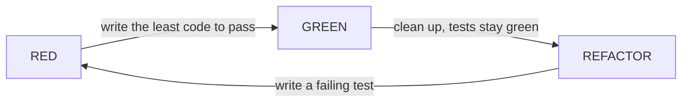

## Why this matters

You change one line in the discount function so annual plans get an extra 5% off. You click through the pricing page, the numbers look right, you deploy. Three weeks later finance notices that customers on the Enterprise tier with a coupon have been invoiced a negative line item because the discounts now stack past 100%. Nobody clicked that combination. Nobody would.

Manual checking scales with your patience, not with your codebase. A unit test suite is a list of claims about your code that a machine re-checks in under a second, every time anything changes. For money math in a SaaS or ERP product, that is not a nice-to-have: an off-by-one-cent rounding bug multiplied across 40,000 invoices is a support incident, an accounting reconciliation, and sometimes a legal problem.

You have been writing Vitest tests since the Phase 1 lesson *Testing from Day One*: AAA, fakes injected through constructors, contract tests that run against both the fake and the real implementation. This lesson assumes all of that and goes deeper on the hardest unit-level target in a SaaS codebase, money logic: sharpening what a "unit" is, choosing between test-double styles deliberately, testing money exactly, attacking boundaries and hostile input, and driving a feature with test-driven development (TDD).

## What a unit is

A unit is the smallest piece of behaviour that is meaningful on its own and can be checked without touching the outside world. It is usually a function or a class, but the definition is about behaviour, not syntax.

Good candidates for unit tests:

- Pure calculation: discount tiers, tax, proration, invoice totals, currency rounding.
- Validation and parsing: "is this a valid VAT number", "parse this CSV row into an order line".
- State transitions: "an invoice in `draft` can move to `sent`, but `paid` cannot go back to `draft`".
- Decision logic inside services, once the I/O has been pushed out to injected dependencies.

Poor candidates:

- A function that is one line of SQL. Testing it with a mocked database proves nothing; test it with a real database (next lesson).
- Glue code that only forwards arguments. A test there just restates the implementation.

The practical rule: **unit tests do not touch the network, the filesystem, the clock, randomness, or a database.** If your code needs any of those, either inject them or test that code at the integration level.

### Two schools

There are two traditions you will hear about:

| Style | A "unit" is | Doubles are used for | Strength | Weakness |
|---|---|---|---|---|
| Classicist (Detroit) | A behaviour, possibly spanning several real classes | Only awkward dependencies (DB, HTTP, clock) | Tests survive refactors | Failures can be further from the cause |
| Mockist (London) | A single class | Every collaborator | Pinpoints failures | Tests break when you restructure internals |

For business logic, lean classicist. You care that `calculateInvoice` returns the right total, not that it called `applyDiscount` exactly once.

## Setting up Vitest

You already have Vitest from Phase 1; for this phase add the coverage provider, which is a separate package (`--coverage` fails with a prompt to install it otherwise):

```bash
npm install -D vitest @vitest/coverage-v8
```

```json
{
  "scripts": {
    "test": "vitest run",
    "test:watch": "vitest"
  }
}
```

```ts
// vitest.config.ts
import { defineConfig } from "vitest/config";

export default defineConfig({
  test: {
    include: ["src/**/*.test.ts"],
    environment: "node",
    coverage: { provider: "v8", reporter: ["text", "html"] },
  },
});
```

Put tests next to the code: `src/billing/discount.ts` and `src/billing/discount.test.ts`. You find them faster and they move together.

## Arrange, Act, Assert

A quick refresher, since you have used it since Phase 1: every test has the same three phases, and making them visible is the single biggest readability win.

```ts
import { describe, it, expect } from "vitest";
import { applyTierDiscount } from "./discount";

describe("applyTierDiscount", () => {
  it("gives 10% off to Growth tier on monthly billing", () => {
    // Arrange
    const subtotalCents = 10_000;

    // Act
    const result = applyTierDiscount({ subtotalCents, tier: "growth", cycle: "monthly" });

    // Assert
    expect(result.discountCents).toBe(1_000);
    expect(result.totalCents).toBe(9_000);
  });
});
```

Rules that keep AAA honest:

- **One Act per test.** If you call the function twice, you are testing two things.
- **Assert on behaviour the caller sees**, not intermediate variables.
- **Name the test as a sentence** describing the rule. When it fails in CI, the name alone should tell you which business rule broke.

## Money math: integers, not floats

JavaScript numbers are IEEE-754 doubles. `0.1 + 0.2` is `0.30000000000000004`. Multiply that by a tax rate and round at the wrong moment and you are a cent off on some invoices.

The standard fix: store and compute money as **integer minor units** (cents), and round exactly once, at a defined point, with a defined rule.

```ts
// src/billing/money.ts
export type Cents = number;

export function assertCents(value: number, label = "amount"): asserts value is Cents {
  if (!Number.isSafeInteger(value)) {
    throw new RangeError(`${label} must be a safe integer number of cents, got ${value}`);
  }
}

// Banker's rounding (round half to even) avoids systematic upward bias across many lines.
export function roundHalfEven(value: number): number {
  const floor = Math.floor(value);
  const diff = value - floor;
  if (diff > 0.5) return floor + 1;
  if (diff < 0.5) return floor;
  return floor % 2 === 0 ? floor : floor + 1;
}

// Percentages expressed in basis points: 1 bp = 0.01%. 2000 bp = 20%.
export function percentOf(amount: Cents, basisPoints: number): Cents {
  return roundHalfEven((amount * basisPoints) / 10_000);
}
```

Now the discount logic, with explicit rules a business person could read:

```ts
// src/billing/discount.ts
import { assertCents, percentOf, type Cents } from "./money";

export type Tier = "starter" | "growth" | "enterprise";
export type Cycle = "monthly" | "annual";

const TIER_BP: Record<Tier, number> = { starter: 0, growth: 1_000, enterprise: 2_000 };
const ANNUAL_BONUS_BP = 500;
const MAX_DISCOUNT_BP = 5_000; // never more than 50% off

export function applyTierDiscount(input: {
  subtotalCents: Cents;
  tier: Tier;
  cycle: Cycle;
  couponBp?: number;
}) {
  const { subtotalCents, tier, cycle, couponBp = 0 } = input;
  assertCents(subtotalCents, "subtotalCents");
  if (subtotalCents < 0) throw new RangeError("subtotalCents cannot be negative");
  if (!Object.prototype.hasOwnProperty.call(TIER_BP, tier)) throw new TypeError(`unknown tier: ${String(tier)}`);
  if (!Number.isInteger(couponBp) || couponBp < 0 || couponBp > 10_000) {
    throw new RangeError("couponBp must be an integer between 0 and 10000");
  }

  const totalBp = Math.min(
    TIER_BP[tier] + (cycle === "annual" ? ANNUAL_BONUS_BP : 0) + couponBp,
    MAX_DISCOUNT_BP,
  );
  const discountCents = percentOf(subtotalCents, totalBp);
  return { discountCents, totalCents: subtotalCents - discountCents, appliedBp: totalBp };
}
```

## Edge cases and invalid input

The happy path is the test you write first and the one that matters least. Bugs live at the boundaries. For any numeric business function, walk this checklist:

```
  zero           -> 0 cents, 0% rate, empty cart
  one            -> 1 cent (rounding of tiny values)
  boundary       -> exactly at a tier threshold, exactly at the cap
  boundary +/- 1 -> one cent above/below the threshold
  large          -> Number.MAX_SAFE_INTEGER territory, 1,000,000 seats
  negative       -> refunds? or reject?
  wrong type     -> NaN, Infinity, "100", null, undefined
  unknown enum   -> tier: "platinum"
```

`it.each` keeps table-driven cases compact:

```ts
describe("applyTierDiscount - boundaries", () => {
  it.each([
    { tier: "starter", cycle: "monthly", coupon: 0, expected: 0 },
    { tier: "growth", cycle: "annual", coupon: 0, expected: 1_500 },
    { tier: "enterprise", cycle: "annual", coupon: 0, expected: 2_500 },
    // stacking hits the 50% cap
    { tier: "enterprise", cycle: "annual", coupon: 4_000, expected: 5_000 },
  ] as const)("$tier/$cycle with coupon $coupon bp => $expected bp", ({ tier, cycle, coupon, expected }) => {
    const r = applyTierDiscount({ subtotalCents: 10_000, tier, cycle, couponBp: coupon });
    expect(r.appliedBp).toBe(expected);
    expect(r.totalCents).toBeGreaterThanOrEqual(5_000);
  });

  it("rounds half to even on a 1-cent remainder", () => {
    // 10% of 5 cents = 0.5 -> rounds to 0 (even), not 1
    expect(applyTierDiscount({ subtotalCents: 5, tier: "growth", cycle: "monthly" }).discountCents).toBe(0);
    // 10% of 15 cents = 1.5 -> rounds to 2 (even)
    expect(applyTierDiscount({ subtotalCents: 15, tier: "growth", cycle: "monthly" }).discountCents).toBe(2);
  });
});

describe("applyTierDiscount - invalid input", () => {
  it.each([NaN, Infinity, 10.5, -1])("rejects subtotal %s", (bad) => {
    expect(() => applyTierDiscount({ subtotalCents: bad, tier: "growth", cycle: "monthly" })).toThrow(RangeError);
  });

  it("rejects an unknown tier coming from untrusted JSON", () => {
    const fromRequest = JSON.parse('{"tier":"platinum"}');
    expect(() =>
      applyTierDiscount({ subtotalCents: 100, tier: fromRequest.tier, cycle: "monthly" }),
    ).toThrow(/unknown tier/);
  });

  it("rejects a coupon over 100% that would create a negative invoice", () => {
    expect(() =>
      applyTierDiscount({ subtotalCents: 100, tier: "starter", cycle: "monthly", couponBp: 15_000 }),
    ).toThrow(RangeError);
  });
});
```

Note `toThrow(RangeError)` rather than a bare `toThrow()`. A bare `toThrow()` also passes when the code crashes with `TypeError: cannot read properties of undefined`, which hides real bugs.

TypeScript types protect you at compile time only. Data from HTTP bodies, CSV imports and webhooks arrives as `unknown` at runtime, so your business functions should still validate at their boundary.

## Test doubles: stubs, mocks, fakes, spies

When a unit has a dependency you cannot run in a unit test, you substitute a test double. The names matter because they imply different kinds of assertions.

| Double | What it does | You assert on | Example |
|---|---|---|---|
| Dummy | Fills a parameter, never used | Nothing | `null as any` logger |
| Stub | Returns canned answers | The unit's output | Tax-rate lookup that always returns 2000 bp |
| Spy | Records calls to a real or stub function | How it was called | `vi.fn()` wrapped around an email sender |
| Mock | Pre-programmed with expectations, fails if not met | The interaction itself | "must call `charge` once with 9000" |
| Fake | Working, simplified implementation | The unit's output | In-memory `InvoiceRepository` backed by a `Map` |

Here is an invoice service that depends on a tax-rate provider, a repository, and a clock:

```ts
// src/billing/invoice-service.ts
export interface TaxRates { rateBpFor(countryCode: string): Promise<number> }
export interface InvoiceRepo {
  save(inv: Invoice): Promise<void>;
  findById(id: string): Promise<Invoice | undefined>;
}
export interface Clock { now(): Date }

export type Invoice = { id: string; customerId: string; netCents: number; taxCents: number; issuedAt: Date };

export class InvoiceService {
  constructor(private tax: TaxRates, private repo: InvoiceRepo, private clock: Clock) {}

  async issue(id: string, customerId: string, netCents: number, country: string): Promise<Invoice> {
    const rateBp = await this.tax.rateBpFor(country);
    const taxCents = Math.round((netCents * rateBp) / 10_000);
    const invoice = { id, customerId, netCents, taxCents, issuedAt: this.clock.now() };
    await this.repo.save(invoice);
    return invoice;
  }
}
```

The test uses a stub for tax rates, a fake for the repository, and a fixed clock:

```ts
import { describe, it, expect, vi } from "vitest";
import { InvoiceService, type Invoice, type InvoiceRepo } from "./invoice-service";

class InMemoryInvoiceRepo implements InvoiceRepo {
  private rows = new Map<string, Invoice>();
  async save(inv: Invoice) { this.rows.set(inv.id, inv); }
  async findById(id: string) { return this.rows.get(id); }
}

describe("InvoiceService.issue", () => {
  it("applies the country VAT rate and persists the invoice", async () => {
    const taxStub = { rateBpFor: vi.fn().mockResolvedValue(1_900) }; // 19% DE VAT
    const repo = new InMemoryInvoiceRepo();
    const clock = { now: () => new Date("2026-01-01T00:00:00Z") };
    const service = new InvoiceService(taxStub, repo, clock);

    const inv = await service.issue("inv_1", "cus_1", 10_000, "DE");

    expect(inv.taxCents).toBe(1_900);
    expect(await repo.findById("inv_1")).toEqual(inv);
    expect(taxStub.rateBpFor).toHaveBeenCalledWith("DE");
  });
});
```

Notice that the assertion is mainly on state (the saved invoice) rather than on "did `save` get called". State assertions survive refactoring; interaction assertions should be reserved for cases where the interaction *is* the behaviour, such as "a payment provider is charged exactly once".

For the clock, Vitest also offers `vi.useFakeTimers()` and `vi.setSystemTime(...)`, but injecting a `Clock` keeps the dependency explicit.

## TDD: red, green, refactor

Test-driven development is a loop:



Walkthrough: finance asks for **proration** when a customer upgrades mid-cycle. Credit the unused part of the old plan, charge the unused part of the new plan.

**Red 1.** The simplest case first.

```ts
it("charges the full price difference when upgrading on day 0", () => {
  expect(prorate({ oldCents: 2_000, newCents: 5_000, daysUsed: 0, daysInCycle: 30 })).toBe(3_000);
});
```

Run it: fails, `prorate` is not defined. Good. A test that has never been seen failing has never been proven able to fail.

**Green 1.** The least code to pass:

```ts
export function prorate(i: { oldCents: number; newCents: number; daysUsed: number; daysInCycle: number }) {
  return i.newCents - i.oldCents;
}
```

**Red 2.** Add the case that forces the real logic:

```ts
it("charges half the difference at mid-cycle", () => {
  expect(prorate({ oldCents: 2_000, newCents: 5_000, daysUsed: 15, daysInCycle: 30 })).toBe(1_500);
});
```

**Green 2.**

```ts
export function prorate(i: { oldCents: number; newCents: number; daysUsed: number; daysInCycle: number }) {
  const remaining = (i.daysInCycle - i.daysUsed) / i.daysInCycle;
  return Math.round((i.newCents - i.oldCents) * remaining);
}
```

**Red 3.** Invalid input: `daysUsed: 31` on a 30-day cycle should throw. **Green 3**: add the guard. **Refactor**: extract the input type, use `roundHalfEven`, rename variables. Tests stay green the whole time, which is what makes refactoring safe.

TDD pays most on logic with clear rules (billing, tax, permissions). It pays less on exploratory UI work, where you do not yet know what you are building.

## Common mistakes

- **Using floats for money.** Testing `toBeCloseTo(29.99)` on a currency value is a smell; you should be asserting exact integers.
- **Mocking what you own just to reach 100% coverage.** Mocking your own repository in every test means the tests pass while the SQL is broken.
- **Asserting on implementation details.** `expect(helper).toHaveBeenCalledTimes(3)` breaks the moment you optimise the loop.
- **One giant test with fifteen asserts.** The first failure hides the rest. Split by rule.
- **Tests that depend on each other or on `Date.now()`.** They pass at 10:00 and fail at midnight on the last day of the month.
- **Only testing the happy path.** The bug is almost always in the boundary or invalid-input case.
- **Bare `toThrow()`.** Always specify the error class or message.

## In the real world

Payment companies treat their pricing engine as the most heavily tested code they own, often with hundreds of table-driven cases maintained together with the finance team. A common pattern is a spreadsheet of "golden" scenarios (tier, seats, coupon, country, expected total) exported to JSON and fed into `it.each`, so when finance changes a rule they change the spreadsheet and the tests fail in exactly the rows that changed.

Coverage numbers are used as a floor, not a goal. Teams commonly enforce something like 80% line coverage on `src/billing/**` and ignore it on UI glue. The meaningful metric is "did the last money bug have a test that would have caught it?" After every incident, add that test first.

## Try it

1. Create `src/billing/tax.ts` with `calculateTax(netCents, region)` supporting at least three regions with different rates and one region with a reduced rate for a product category.
2. Write tests first: one happy-path test per region, boundary tests at 0 and 1 cent, and invalid-input tests for `NaN`, negative amounts, and an unknown region read from `JSON.parse`.
3. Use `it.each` for the regions.
4. Run `npx vitest run --coverage` and confirm every branch of `calculateTax` is covered.
5. Deliberately introduce a bug (swap two rates). Confirm exactly the expected tests fail and their names explain why.
