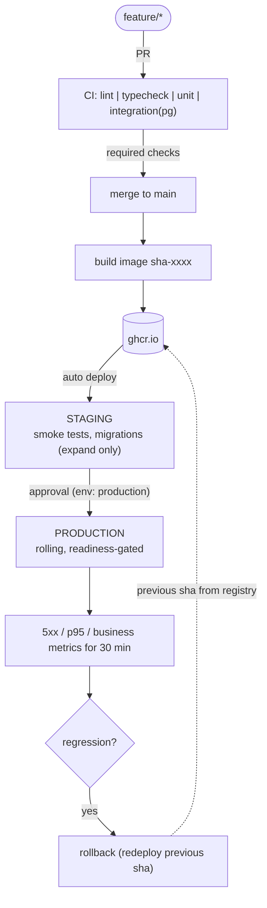

## Scenario

You have just joined a 7-person team building a multi-tenant invoicing and subscription SaaS used by about 400 small businesses in the EU. Current state:

- One GitHub repo: a Node/TypeScript API, a React frontend, a background worker that generates PDF invoices and sends dunning emails, and Postgres.
- Developers push to `main` directly. A GitHub Action runs tests but nobody blocks merges on it.
- Deploys happen on Thursday evenings by the CTO, by SSH, and take 10 minutes of partial downtime.
- Last month a migration dropped a column the worker still used; invoice PDFs failed for 3 hours before a customer reported it.
- Two enterprise customers now require a staging environment where they can preview releases, and the sales contract mentions 99.9% monthly availability.

The CTO asks you for a written and drawn design of the team's delivery pipeline and environments, which the team will then implement. This is a design problem: the deliverable is a diagram and a written decision document, not code. (You will implement a version of it in the capstone.)

## What to design

Your diagram and write-up must cover the full path of a change from a developer's branch to production, and the path back when it goes wrong.

1. **Branching model**: how work flows into `main` (trunk-based with short-lived branches, or something else), and why for a team of 7.
2. **CI stages on pull requests**: which checks run, in what order and in parallel, which are required, target feedback time.
3. **Artifact creation**: when and where images are built, how they are tagged, which registry, what makes them immutable.
4. **Environments**: at minimum preview (optional), staging and production. For each: what triggers a deploy, which data it uses (never real customer data in staging without justification), what secrets it has, who can access it.
5. **Gates**: automated (tests, smoke tests, health checks, metrics) and human (approval) between each environment. Be explicit about which are blocking.
6. **Deployment strategy per component**: API, frontend, worker. The worker is the subtle one: a rolling deploy of a queue consumer must not double-process or drop jobs.
7. **Database migrations**: when they run relative to code rollout, how expand/contract is enforced (review checklist, linter in CI), and how the incident from last month would have been prevented.
8. **Rollback path**: drawn on the diagram. What triggers it, who can trigger it, how long it takes, and what *cannot* be rolled back (sent emails, charged cards, contract migrations).
9. **Post-deploy verification and observability**: what is checked automatically, what alerts exist, how a bad canary or release is detected.

## Constraints

- Budget-conscious: the team cannot afford a dedicated platform engineer. Prefer managed services and GitHub-native features over self-hosted tooling. State the monthly cost order of magnitude of what you choose.
- Must support at least daily deploys during business hours without downtime.
- Enterprise customers get release notes and a staging preview at least 24 hours before features reach production. Decide how this coexists with daily deploys (hint: separate deploying code from releasing features).
- Production secrets must not be readable by pull-request workflows.
- Assume the team will not adopt Kubernetes this year.

## Deliverables

- A **diagram** (in the in-app whiteboard, exported to PNG or SVG) showing: developer branch, PR, CI stages, merge to main, image build, registry, staging, gates, production, rollback path, and where observability feeds back into decisions.
- A **decision document** (`DESIGN.md`, 1-3 pages) explaining each of the nine areas above, with at least three explicit trade-offs written as "We chose X over Y because Z; we accept the cost W."
- A **migration plan**: the ordered steps to move the team from today's process to the target, small enough that nothing breaks during the transition.

## Example fragment of a good diagram

Yours must be more complete than this: include the worker, the frontend, feature flags, and where the migration linter sits.

## How to verify

- Walk a hypothetical change through your diagram: "add a `discount_reason` column and show it on the invoice PDF". Every step should be on the diagram and in the document.
- Walk last month's incident through it. Point to the exact gate that stops it.
- Walk a bad release through it: the API returns 500 on `POST /invoices` for 5% of tenants. Who notices, how fast, and how is it reversed?
- Ask: can a pull request from a fork read the production deploy key? The answer must be no, and your document says why.
