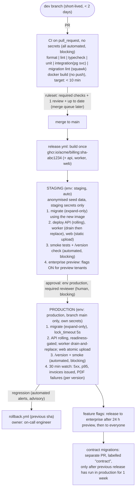

## What a strong solution looks like

A strong design is boring on purpose. It uses GitHub-native features (rulesets, Actions, environments, GHCR) plus one managed hosting platform, and it fits on one diagram that a new engineer can follow from `git push` to "customer sees it". Every incident in the brief maps to a specific box: the dropped-column outage is stopped by a migration linter plus an expand/contract policy; unblocked merges are stopped by required checks; Thursday downtime is replaced by readiness-gated rolling or blue-green deploys during business hours; the enterprise preview requirement is met by separating deploying (daily) from releasing (feature flags).

The written document is honest about limits. It lists what rollback cannot undo, states a realistic cost, and says what the team will *not* build this year. Trade-offs are explicit sentences, not a list of tools.

## Reference approach

### Diagram, described

### Decisions per area

- **Branching**: trunk-based with short-lived branches. Seven people do not need release branches, and long-lived branches are what make Thursday deploys large and risky.
- **CI**: the jobs above in parallel, all required. Fork and PR workflows use `permissions: contents: read` and receive no secrets; nothing in CI needs one.
- **Artifacts**: one image per component per commit, tagged with the short SHA, pushed only from `main` by `release.yml` with `GITHUB_TOKEN` and `packages: write`. Tags are never reused. The frontend is a static build stored as a versioned artifact (or in a container image) so it can be rolled back the same way.
- **Environments**: staging gets anonymised or synthetic data (never a raw production copy, because that brings GDPR obligations into a less protected environment). Production secrets exist only in the `production` environment, which is restricted to `main` and requires a reviewer.
- **Strategies**: API rolling with readiness gating on the platform (or blue-green on a VM); frontend uploaded atomically to a CDN with previous builds kept, so old HTML never points at deleted assets; worker deployed by draining.
- **Worker**: on SIGTERM it stops pulling jobs, finishes the current job within a timeout, and otherwise lets the lock expire so the job is retried. Jobs are idempotent: dunning emails use an idempotency key (`dunning:{invoiceId}:{step}`) recorded in Postgres before sending, so a retry cannot send twice. The new worker must accept job payloads produced by the old version (additive payload changes only).
- **Migrations**: run as a pipeline step before code rollout, using the new image. Squawk in CI blocks `DROP`, `RENAME`, type changes and non-concurrent index creation unless the PR carries a `contract` label and a second reviewer. Last month's incident: the drop would have failed the lint, and the policy would have required proving that no deployed component (including the worker) still reads the column.
- **Rollback**: `rollback.yml` (workflow_dispatch, input: tag) calls the same deploy script. Trigger: post-deploy alerts or a human judgement within the watch window. Owner: whoever is on call. Expected duration: 3-5 minutes. Cannot be rolled back: sent emails, card charges, PDFs delivered to customers, contract migrations, and data written in a new format that old code cannot read. For those, roll forward.
- **Observability**: pino JSON logs with `version`, RED metrics per route, business counters (invoices issued, PDF generation failures, dunning sent), Sentry with release tracking, an external uptime check.

### Back-of-envelope numbers

- 99.9% monthly availability allows about 43 minutes of downtime per month. Today's process spends roughly 10 minutes per weekly deploy, around 40 minutes a month, on planned downtime alone; the current process cannot meet the contract.
- Daily deploys at about 20 working days is 20 deploys a month. With a 4-minute rollback and the error budget above, the team can afford a few bad releases a month only if detection is fast, which is why the 30-minute watch matters.
- Cost order of magnitude: GitHub Team for 7 users is tens of dollars a month; Actions minutes for a 10-minute pipeline at a few dozen runs a day typically fit in included minutes or cost tens of dollars; a managed platform for staging plus production (two small API instances, a worker, managed Postgres with backups) is low hundreds; logs, errors and metrics on hosted free or starter tiers are tens to low hundreds. Total: roughly 200-600 USD a month, far below one platform engineer.

### Migration plan (no big bang)

1. Turn on required checks and a ruleset for `main` with the existing tests. Fix flaky tests first.
2. Add the missing CI gates (typecheck, format, integration with a Postgres service, squawk in advisory mode).
3. Containerise and push SHA-tagged images to GHCR from `main`, while still deploying the old way.
4. Stand up staging from those images; add smoke tests.
5. Move production to the platform with readiness-gated deploys; run old and new in parallel for a week behind DNS.
6. Make squawk blocking, add feature flags, start daily business-hours deploys, and retire SSH access.

## Common mistakes

- **A tool list instead of a design.** "GitHub Actions, Docker, Sentry" does not say what gates what.
- **Ignoring the worker.** Many designs deploy the API carefully and then kill the worker mid-job, which double-sends dunning emails or leaves half-generated PDFs.
- **Rebuilding per environment.** Staging and production run different bytes, and the staging sign-off proves nothing.
- **Weekly release trains to satisfy the enterprise preview.** This throws away daily deploys; feature flags solve the requirement without slowing everyone down.
- **Claiming rollback fixes everything.** Emails, charges and destructive migrations are one-way.
- **Copying production data to staging** without addressing GDPR.
- **Kubernetes or self-hosted tooling** for a team that explicitly cannot run it.

## Trade-offs worth discussing

- **Rolling versus blue-green for the API.** Rolling is cheaper and native to most platforms; blue-green gives instant switch-back and a full smoke test before traffic, at double capacity during deploys.
- **Human approval before production.** It slows lead time and approvals become rubber stamps; the alternative is automatic promotion gated on smoke tests and canary metrics, which needs better observability first.
- **Merge queue now or later.** At seven people, "require up to date" may be enough; a merge queue avoids the rebase churn as PR volume grows.
- **Feature flag vendor versus a flags table.** A vendor adds targeting and audit; a Postgres table with tenant-level flags is cheap but needs its own admin UI and cleanup discipline.
- **Preview environments per PR.** Great for review and enterprise demos, but each needs a database and costs money; staging plus flags may be enough.

## Grade yourself

| Dimension | Strong | Acceptable | Needs work |
|---|---|---|---|
| Completeness of path | Diagram covers branch to production for API, web and worker, plus registry, both environments, flags and linter placement | Full path for the API; worker or web only mentioned in text | Gaps between CI and production, or no registry |
| Gates | Every gate labelled automated/human and blocking/advisory; each brief incident mapped to a gate | Gates drawn but labelling or incident mapping incomplete | Approval is the only real gate |
| Migrations | Expand-only before rollout, linter in CI with a contract-label escape hatch, dropped-column incident walked through | Policy stated, enforcement left to review | Migrations run at app start or in the same release as the code that stops using a column |
| Rollback and limits | Drawn path, trigger, owner, duration, and a concrete list of irreversible effects | Path drawn, limits vague | "Redeploy the old version" with no detail |
| Secrets and environments | Production secrets only in a protected environment; fork and PR workflows explicitly secretless; staging data policy stated | Environment secrets used, PR exposure not discussed | Repository-level production secrets |
| Feasibility and cost | Three or more explicit trade-offs, cost estimate with order of magnitude, incremental migration plan | Trade-offs present, cost or plan thin | Big-bang switch or tooling the team cannot operate |

## Going further

- Add per-PR preview environments with a seeded, short-lived database and automatic teardown, and estimate their monthly cost.
- Define two SLOs (availability and `POST /invoices` latency) and write a release policy driven by error-budget burn.
- Design an automated canary stage for the API with promotion and abort criteria based on per-version 5xx rate and p95 latency.
