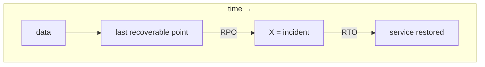
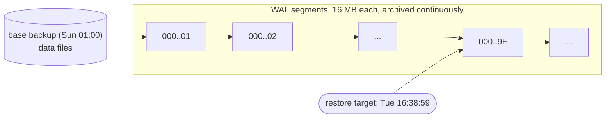
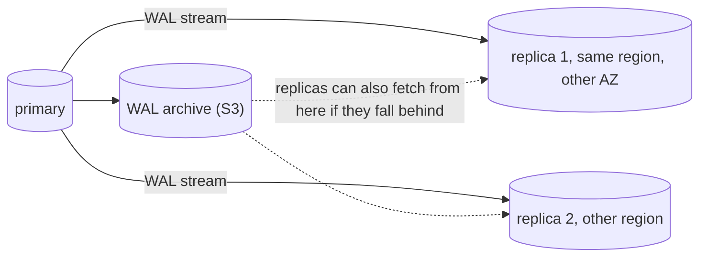

## Why this matters

A support engineer runs a cleanup script against what they think is staging. It is production. `DELETE FROM invoice_lines WHERE created_at < '2026-01-01'` removes ten months of billing history for every tenant. The team has "nightly backups", so they relax. Then they find out:

- The last good dump is from 02:00. It is now 16:40. Fourteen hours of invoices, payments and inventory moves would be lost by restoring it.
- Restoring the 180 GB dump takes 5 hours, because nobody had ever timed it.
- The dump does not include roles, so the restored database has no `app_rw` user and the app cannot connect.

None of that is a hardware failure. Backups and high availability (HA) solve different problems, and you need both, measured, before the bad day. This lesson covers how Postgres backups really work, point-in-time recovery, replication and failover, and how to write the runbook you will follow under pressure.

## RPO and RTO: the two numbers that drive every decision

- **RPO (Recovery Point Objective)**: how much data you can afford to lose, measured in time. "RPO 5 minutes" means after any incident you can restore to within 5 minutes of the failure.
- **RTO (Recovery Time Objective)**: how long you can be down while recovering.



These are business decisions with costs. For a B2B ERP, a typical target is RPO under 5 minutes and RTO under 1 hour for a disaster, and near-zero RPO with RTO under 2 minutes for a single server failure. Write them down, then design to them and **measure** them in drills. An unmeasured RTO is a guess.

Also separate the failure types, because each needs a different tool:

| Failure | Example | Tool |
|---|---|---|
| Server / AZ dies | disk failure, instance crash | replication + failover (HA) |
| Logical corruption | bad `DELETE`, buggy migration | point-in-time recovery (PITR) |
| Region lost | cloud region outage | cross-region replica or backups (DR) |
| Malicious / ransomware | attacker deletes DB and backups | immutable, separately-credentialed backups |

Replication does **not** protect against the bad `DELETE`: the replica applies it within milliseconds.

## Logical vs physical backups

### Logical: pg_dump

`pg_dump` connects as a client and exports SQL-level objects and data from a consistent snapshot.

```bash
# custom format: compressed, supports selective and parallel restore
pg_dump -Fc -d erp -f erp_2026-11-11.dump
# roles and tablespaces are cluster-wide and NOT in pg_dump
pg_dumpall --globals-only -f globals.sql

pg_restore -d erp_restore -j 8 --no-owner erp_2026-11-11.dump
```

Good for: small databases, copying one tenant or table, major-version upgrades, long-term archival in a portable format. Bad for: large databases (restore rebuilds every index, which is slow), and RPO, because you only have the moment the dump started.

### Physical: base backups plus WAL

Postgres writes every change to the **write-ahead log (WAL)** before changing data files. A physical backup is a copy of the data directory (a **base backup**) plus the continuous stream of WAL segments since then. Replaying WAL on top of the base backup can bring the database to **any moment** covered by the archive. That is point-in-time recovery.



| | pg_dump | Base backup + WAL |
|---|---|---|
| Granularity | moment of dump | any second within retention |
| Restore speed (large DB) | slow (rebuild indexes) | fast (copy files, replay WAL) |
| Portable across major versions | yes | no |
| Single table restore | easy | restore whole cluster elsewhere, then copy |
| Typical RPO | hours | seconds to a minute |

Production systems use physical backups with WAL archiving as the primary mechanism and occasional logical dumps as a secondary, portable copy.

## WAL archiving and PITR with pgBackRest or WAL-G

You can wire `archive_command` and `pg_basebackup` yourself, but the dedicated tools handle compression, encryption, parallelism, retention, checksums and object storage. The two common ones are **pgBackRest** and **WAL-G**.

pgBackRest example (repository in S3-compatible storage such as MinIO):

```ini
# /etc/pgbackrest/pgbackrest.conf
[global]
repo1-type=s3
repo1-s3-endpoint=minio:9000
repo1-s3-bucket=pg-backups
repo1-s3-region=us-east-1
repo1-s3-uri-style=path
repo1-path=/erp
repo1-retention-full=2
repo1-cipher-type=aes-256-cbc   # plus repo1-cipher-pass, injected as a secret
compress-type=zst
start-fast=y

[main]
pg1-path=/var/lib/postgresql/data
```

```
# postgresql.conf
wal_level = replica
archive_mode = on
archive_command = 'pgbackrest --stanza=main archive-push %p'
archive_timeout = 60          # force a segment switch at least every 60 s
```

```bash
pgbackrest --stanza=main stanza-create
pgbackrest --stanza=main check            # verifies archiving works end to end
pgbackrest --stanza=main --type=full backup
pgbackrest --stanza=main --type=diff backup   # daily differentials
pgbackrest --stanza=main info
```

`archive_timeout` matters for RPO: on a quiet database a 16 MB segment might take an hour to fill, and an unarchived segment is lost with the server. With 60 seconds, worst-case RPO from archives alone is about a minute.

Point-in-time restore to just before the bad `DELETE`:

```bash
# stop postgres, then:
pgbackrest --stanza=main --delta \
  --type=time --target="2026-11-11 16:38:59+00" \
  --target-action=promote restore
# start postgres; it replays WAL up to the target and promotes
```

Under the hood this writes `restore_command` and `recovery_target_time` and creates `recovery.signal` (Postgres 12+). The WAL-G equivalent uses `wal-g backup-fetch` and `restore_command = 'wal-g wal-fetch %f %p'`. Finding the exact target is the hard part: look for the statement in logs or `pg_stat_statements`, or recover to a time and inspect, then try again. Better practice: **restore into a new instance**, verify, then copy the missing rows back into production, rather than rewinding production and losing the 2 hours of good writes that happened after the delete.

Postgres 17 added native incremental backups (`pg_basebackup --incremental` plus `pg_combinebackup`), which narrows the gap with the dedicated tools, but pgBackRest and WAL-G still give you retention, encryption and object storage handling out of the box.

### Test your restores

A backup you have not restored is a hypothesis. Automate it:

- Weekly job: restore the latest backup into a throwaway instance, run `SELECT count(*)` on key tables and an application smoke test, record the duration.
- Alert if the newest successful backup is older than 26 hours or the WAL archive is stale (`pg_stat_archiver.last_failed_time` newer than `last_archived_time`).
- Run `pg_amcheck` or a full read of the restored data periodically to catch silent corruption.

That weekly duration **is** your measured RTO for the restore path.

## Streaming replication

A replica (standby) connects to the primary and receives WAL as it is written, replaying it continuously.



```
# primary postgresql.conf
wal_level = replica
max_wal_senders = 10
max_slot_wal_keep_size = 50GB   # cap WAL retained for a dead replica's slot

# replica: standby.signal file present, and
primary_conninfo = 'host=pg-primary user=replicator sslmode=verify-full'
primary_slot_name = 'replica1'
```

### Synchronous vs asynchronous

| | Asynchronous (default) | Synchronous |
|---|---|---|
| Commit returns when | WAL flushed on primary | WAL confirmed by standby (level per `synchronous_commit`) |
| Data loss on primary crash | the last few ms to seconds | none for committed transactions |
| Commit latency | unchanged | + network round trip to standby |
| If standby is down | no effect | commits **hang** unless another standby qualifies |

```
synchronous_standby_names = 'ANY 1 (replica1, replica2)'
synchronous_commit = on   # or remote_apply: also visible on the standby
```

`ANY 1` of two standbys is the usual compromise: zero data loss on failover, and one standby can die without freezing writes. You can also relax it per transaction: `SET LOCAL synchronous_commit = local` for an analytics write that does not need the guarantee.

Monitor lag on the primary:

```sql
SELECT application_name, state, sync_state,
       write_lag, flush_lag, replay_lag,
       pg_wal_lsn_diff(pg_current_wal_lsn(), replay_lsn) AS bytes_behind
FROM pg_stat_replication;
```

An abandoned replication slot keeps WAL forever and fills the primary's disk. `max_slot_wal_keep_size` caps that; alert on inactive slots in `pg_replication_slots`.

## Failover

Failover means promoting a replica to primary and pointing clients at it. The hard parts are deciding the primary is really dead and making sure the old one cannot come back and accept writes.

### Split brain

If the network partitions and both nodes believe they are primary, both accept writes and the data diverges. Merging is manual and painful. Prevention requires **consensus** and **fencing**:

- **Patroni** keeps a leader key with a TTL in a distributed configuration store (etcd, Consul, or Kubernetes). Only the node holding the key runs as primary. A primary that cannot renew the key demotes itself; a watchdog can reboot a hung node.
- After failover, the old primary is rewound with `pg_rewind` and rejoins as a replica.
- Never build failover from "ping the primary and promote if it does not answer". That is exactly how split brain happens.

### Managed failover

| Service | HA model (summary) |
|---|---|
| RDS Multi-AZ instance | synchronous standby in another AZ, not readable; DNS endpoint flips, typically 1-2 minutes |
| RDS Multi-AZ DB cluster / Aurora | readable standbys; Aurora shares a storage layer across AZs, failover typically well under a minute |
| Cloud SQL HA | regional instance with standby in another zone, same IP after failover |
| Neon / Supabase | provider-managed; check the plan for HA, read replicas and PITR retention |

Exact timings vary by version and configuration; check your provider's docs and, more importantly, trigger a failover in staging and time it.

### Connection routing after failover

The database failing over in 30 seconds is useless if the app keeps talking to the old address for 10 minutes.

- **DNS-based** (RDS, Aurora): the endpoint CNAME changes. Long-lived pooled connections still point at the old host; they fail and must be replaced. Keep DNS caching short and make the pool discard broken connections.
- **Proxy-based**: HAProxy in front of Patroni uses Patroni's REST API (`GET /primary` returns 200 only on the leader) as its health check. PgBouncer can sit behind it for pooling.
- **Client-side**: libpq-based clients accept multiple hosts with `target_session_attrs=read-write`, so the driver finds the writable node itself. Check whether your Node driver supports this before relying on it.

On the application side: retry idempotent operations on connection errors with backoff, make the pool validate connections, and expect a burst of errors during failover. Test it.

## Disaster recovery across regions

For region loss, choose by RPO/RTO and budget:

- **Backups copied to another region** (cheapest): RPO = archive lag, RTO = hours (provision + restore).
- **Cross-region async replica** (or Aurora Global Database): RPO = seconds of lag, RTO = minutes (promote + repoint DNS).
- Keep backup storage in a **separate account** with object lock / immutability so a compromised production credential cannot delete the backups too.

## A DR runbook

A runbook is written for a tired person at 03:00. Keep it in the repo, next to the infrastructure code.

```
RUNBOOK: Restore to point in time (logical corruption)

Trigger: data destroyed or corrupted by a bad statement or deploy.
Owner: on-call DB engineer. Comms: incident channel + status page.

1. Stop the damage: disable the offending job / revert the deploy.
2. Record the incident time window from logs (UTC).
3. Find the target: last good transaction time T (pg logs, audit log).
4. Restore to a NEW instance:  pgbackrest ... --type=time --target="T" restore
5. Verify on the new instance: row counts, checksums of key tables,
   the specific rows that were lost.
6. Decide: (a) copy missing rows back into prod, or
           (b) promote the restored instance and repoint the app (loses writes after T).
7. Validate the app: smoke tests, finance spot checks.
8. Record actual RPO and RTO; schedule the postmortem.
```

Write a second one for failover, including how to verify the old primary is fenced and how to rebuild a replica.

## Common mistakes

- **Treating replicas as backups.** Replication copies the `DELETE` too.
- **Never restoring.** Unknown RTO, and sometimes the backups are empty or encrypted with a lost key.
- **Forgetting globals.** `pg_dump` alone has no roles or grants.
- **No `archive_timeout`** on quiet databases, so RPO is silently an hour.
- **Abandoned replication slots** filling the primary disk.
- **Synchronous replication with one standby**, so the standby going down freezes all writes.
- **Homemade failover scripts** without consensus, leading to split brain.
- **Backups in the same account and region** with the same credentials as production.

## In the real world

Most teams on managed Postgres get automated snapshots and PITR with a retention window (often 7 to 35 days) and Multi-AZ failover by ticking a box. The work that remains is yours: setting RPO/RTO, running restore drills, practising failover, handling connection routing in the app, copying backups out of the account, and writing runbooks. GitLab's 2017 database incident, where several backup mechanisms turned out not to be working, is the canonical war story and worth reading. In interviews, expect "replica vs backup", "what is PITR and how does it work", and "how do you avoid split brain".

## Try it

1. Run Postgres in Docker with `archive_mode = on` and an `archive_command` that copies to a mounted folder (`cp %p /archive/%f`).
2. Take a `pg_basebackup`, insert rows for a few minutes, note the time, then `DROP TABLE` something.
3. Restore the base backup into a new container with `restore_command` and `recovery_target_time` set to just before the drop.
4. Time every step. That is your first measured RTO.
