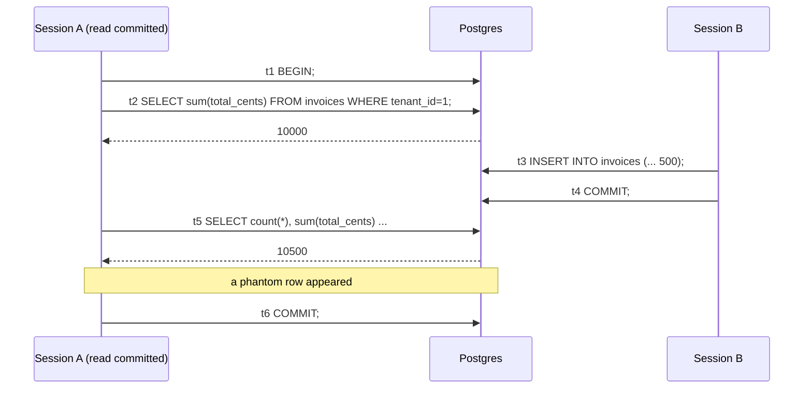
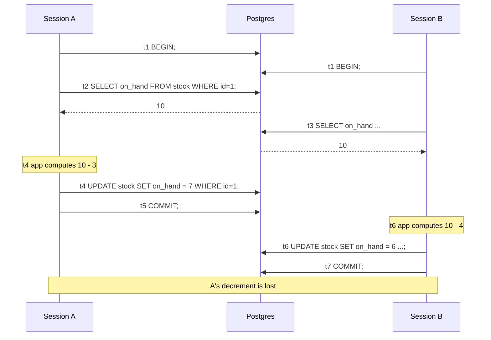
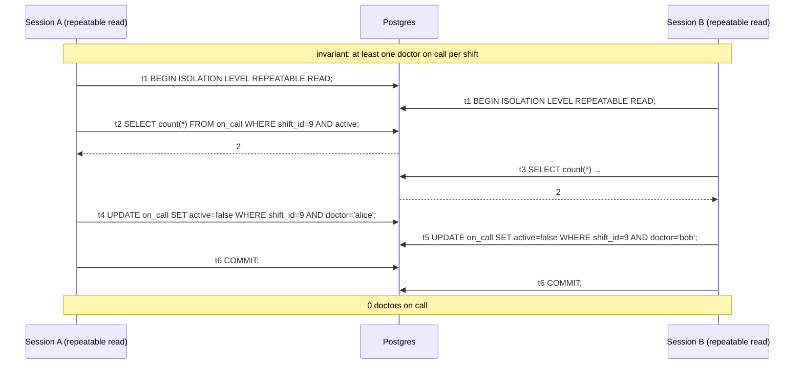
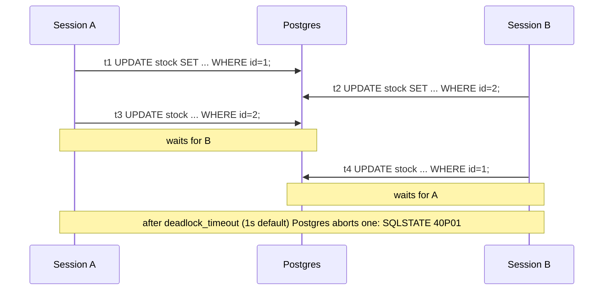

## Why this matters

In Phase 3 you fixed a seat-booking race with an atomic `UPDATE ... WHERE seats_left > 0` and with `SELECT ... FOR UPDATE`. Those fixes work, but they were recipes. Sooner or later you hit a race they do not cover: two managers each approve an expense that fits the remaining budget, and together they blow it. No row was updated twice. No lock was skipped. Each transaction was individually correct, and the result is still wrong.

To reason about that kind of bug, you need the model underneath: what a transaction actually guarantees, what each isolation level allows, how Postgres implements it with MVCC, and which lock or retry pattern closes which gap. This is also one of the most reliably asked senior backend interview topics.

## ACID, concretely

- **Atomicity**: all statements in the transaction take effect, or none do. If the process dies after inserting the invoice but before inserting its lines, neither exists.
- **Consistency**: constraints (FK, CHECK, UNIQUE, exclusion) hold at commit. This is the "C" you get for free only if you declared the rules.
- **Isolation**: concurrent transactions do not see each other's partial work. *How* isolated is configurable, and that is the rest of this lesson.
- **Durability**: once `COMMIT` returns, the change survives a crash, because the WAL record was flushed to disk. (With `synchronous_commit = off` you trade the last few hundred milliseconds of commits for speed; with async replicas, a failover can lose recently committed data.)

## MVCC intuition

Postgres does not overwrite rows. An `UPDATE` writes a new **row version** (tuple) and marks the old one as expired. Each tuple carries the transaction ID that created it (`xmin`) and the one that expired it (`xmax`).

```
invoice id=7
  version A  xmin=100  xmax=205   status='sent'
  version B  xmin=205  xmax=0     status='paid'
```

Each statement (or transaction, depending on isolation level) reads from a **snapshot**: "transactions committed before me are visible, everything else is not". A transaction that started before 205 committed still sees version A. Consequences you will meet in production:

- **Readers never block writers, writers never block readers.** Only writers to the same row wait on each other.
- **Dead tuples accumulate** and `VACUUM` (autovacuum) cleans them once no snapshot can need them.
- **A long-running transaction holds back cleanup for the whole database.** One analytics query open for six hours, or one connection `idle in transaction`, causes table bloat everywhere. Set `idle_in_transaction_session_timeout`.

MySQL InnoDB also uses MVCC, but keeps old versions in an undo log rather than in the table, and adds gap locks for locking reads. The anomalies below differ slightly there; check InnoDB's docs before assuming Postgres behaviour.

## Isolation levels and their anomalies

Postgres offers three distinct levels (`READ UNCOMMITTED` behaves as `READ COMMITTED`):

| Anomaly | Read Committed (default) | Repeatable Read | Serializable |
|---|---|---|---|
| Dirty read | No | No | No |
| Non-repeatable read | **Yes** | No | No |
| Phantom read | **Yes** | No (stricter than SQL standard) | No |
| Lost update (app read-modify-write) | **Yes** | No: error 40001 | No: error 40001 |
| Write skew | **Yes** | **Yes** | No: error 40001 |

Set it per transaction: `BEGIN ISOLATION LEVEL SERIALIZABLE;`. Read Committed takes a new snapshot **per statement**; Repeatable Read and Serializable take one snapshot **per transaction** at its first query.

### Non-repeatable read and phantoms (Read Committed)



A report that runs a header query and a detail query in the same transaction can produce totals that do not match its lines. Fix: run the report at `REPEATABLE READ` (or `READ ONLY DEFERRABLE` serializable for long reports), so every statement sees the same snapshot.

### Lost update



Under Read Committed, B's UPDATE writes the absolute value 6 it computed from a stale read, silently overwriting A's 7. (Had A still been open at t6, B would wait for A's row lock, then overwrite anyway.) Under Repeatable Read, B's UPDATE fails at t6 with `could not serialize access due to concurrent update` (SQLSTATE `40001`) because the row changed after B's snapshot.

Fixes, best first: an atomic `UPDATE stock SET on_hand = on_hand - 4 WHERE id = 1 AND on_hand >= 4` (Read Committed re-evaluates the expression against the newest version), or `SELECT ... FOR UPDATE` at t3 so B waits for A and then reads 7, or a version column (optimistic locking, Phase 3).

### Write skew

The hardest one. Two transactions read an **overlapping set**, then write **different rows**, each preserving the invariant alone but violating it together.



No row was written twice, so row locks never collide and Repeatable Read happily commits both. Same shape: two managers approving expenses against one budget (each inserts a new row, sum checked in the read), two users claiming the last unique username via a "check then insert" without a unique constraint, double-booking without an exclusion constraint.

Fixes:

1. **Serializable.** Postgres's Serializable Snapshot Isolation (SSI) tracks read/write dependencies and aborts one of the two with `40001`. No change to your queries, but you must retry.
2. **Materialize the conflict.** Make both transactions lock a common row: `SELECT ... FROM budgets WHERE id = $1 FOR UPDATE` before summing approvals. Works at Read Committed.
3. **Lock everything you read** (`SELECT ... FOR UPDATE` on all on-call rows of the shift). Works only when the conflicting rows already exist; it cannot lock rows that will be inserted, which is why the budget case needs option 1 or 2.
4. **A constraint**, when the rule fits one (unique, exclusion).

## Row locks: FOR UPDATE, NOWAIT, SKIP LOCKED

```sql
-- wait for the lock (default)
SELECT * FROM invoices WHERE id = $1 FOR UPDATE;

-- fail immediately with 55P03 instead of queueing behind a long transaction
SELECT * FROM invoices WHERE id = $1 FOR UPDATE NOWAIT;

-- weaker lock that does not block inserts of rows referencing this one via FK
SELECT * FROM customers WHERE id = $1 FOR NO KEY UPDATE;
```

`SKIP LOCKED` turns a table into a work queue: each worker grabs rows nobody else is holding.

```sql
WITH next AS (
  SELECT id FROM export_jobs
  WHERE status = 'queued'
  ORDER BY created_at
  LIMIT 10
  FOR UPDATE SKIP LOCKED
)
UPDATE export_jobs j SET status = 'running', started_at = now()
FROM next WHERE j.id = next.id
RETURNING j.*;
```

Ten workers run this concurrently and never get the same job. Use `SKIP LOCKED` only where an inconsistent view is acceptable (queues), never for "is there stock left".

Always pair waiting locks with a timeout so one stuck transaction does not pile up the whole API: `SET LOCAL lock_timeout = '2s'`.

## Advisory locks

Sometimes the thing you want to serialize is not a row: "only one month-end close per tenant at a time", "only one import per file". Advisory locks are application-defined locks on a 64-bit key.

```ts
await db.transaction(async (tx) => {
  const { rows } = await tx.query(
    `SELECT pg_try_advisory_xact_lock(hashtextextended('month-close:' || $1, 0)) AS ok`,
    [tenantId],
  );
  if (!rows[0].ok) throw new AlreadyRunningError();
  await runMonthClose(tx, tenantId);
}); // released automatically at commit/rollback
```

Prefer the `_xact_` variants: they release at transaction end. Session-level `pg_advisory_lock` survives the transaction and is **unsafe behind a transaction-mode pooler** (your next transaction may run on a different server connection, and the lock stays with the old one).

## Deadlocks



Real-world trigger: two orders with the same products in different line order, each decrementing stock line by line. Prevention:

- **Consistent lock ordering.** Sort by key before locking: `lines.sort((a, b) => a.productId - b.productId)`, or lock all upfront with `SELECT ... WHERE id = ANY($1) ORDER BY id FOR UPDATE`.
- **Fewer, bigger statements.** One `UPDATE ... FROM (VALUES ...)` instead of N updates.
- **Short transactions** so the window is small.
- **Treat `40P01` as retryable**, because no ordering discipline is perfect across a large codebase.

## Retry loops for serialization failures

If you use Repeatable Read or Serializable, retries are part of the contract, not an edge case.

```ts
const RETRYABLE = new Set(["40001", "40P01"]); // serialization_failure, deadlock_detected

export async function withSerializableTx<T>(
  pool: Pool,
  fn: (c: PoolClient) => Promise<T>,
  maxAttempts = 5,
): Promise<T> {
  for (let attempt = 1; ; attempt++) {
    const client = await pool.connect();
    try {
      await client.query("BEGIN ISOLATION LEVEL SERIALIZABLE");
      const result = await fn(client);
      await client.query("COMMIT"); // 40001 can be raised here too
      return result;
    } catch (err: any) {
      await client.query("ROLLBACK").catch(() => {});
      if (!RETRYABLE.has(err.code) || attempt >= maxAttempts) throw err;
      const backoff = Math.random() * 20 * 2 ** attempt; // jittered exponential
      await new Promise((r) => setTimeout(r, backoff));
    } finally {
      client.release();
    }
  }
}
```

Rules: the **whole** transaction body is re-run, including the reads (never retry just the failed statement); no side effects inside `fn` (emails, HTTP calls, queue publishes) unless they are idempotent or go through an outbox; cap attempts and alert on the retry rate.

## Keep transactions short

Long transactions hold row locks, block DDL (a migration's `ALTER TABLE` queues behind them, and every query queues behind the migration), and pin MVCC cleanup.

```ts
// Bad: network call inside the transaction
await db.transaction(async (tx) => {
  const inv = await tx.invoice.update({ where: { id }, data: { status: "sent" } });
  await stripe.invoices.finalize(inv.stripeId); // 800 ms, sometimes 30 s
  await tx.auditLog.create({ ... });
});

// Better: transaction only around database state; external call via outbox
await db.transaction(async (tx) => {
  await tx.invoice.update({ where: { id }, data: { status: "sending" } });
  await tx.outbox.create({ data: { type: "finalize_invoice", invoiceId: id } });
});
```

Set guardrails in the role or connection: `statement_timeout`, `lock_timeout`, `idle_in_transaction_session_timeout`.

## Common mistakes

- Believing `BEGIN ... COMMIT` alone prevents races. At Read Committed it prevents partial writes, not interleaving.
- Switching to Serializable without adding retries, then shipping a 40001 error to users under load.
- Retrying only the failing statement instead of the whole transaction.
- Locking rows in data-dependent order and getting intermittent deadlocks at month-end.
- Using `FOR UPDATE` to protect an invariant over rows that do not exist yet (inserts), which cannot be locked.
- Session-level advisory locks behind PgBouncer in transaction mode.
- HTTP calls, file uploads or `await sleep` inside a transaction.

## In the real world

Most production Postgres runs at Read Committed with targeted atomic updates and `FOR UPDATE`, plus Serializable for a few critical flows (ledger postings, approvals, inventory allocation) wrapped in a retry helper. Job queues built on `SKIP LOCKED` (pg-boss, graphile-worker, Oban in Elixir) are common and work well into thousands of jobs per second. Deadlocks show up in logs as `deadlock detected` with both queries listed; the fix is almost always ordering.

Interview prompts: "Two requests decrement the same balance, what can go wrong and how do you fix it at each isolation level?", "Explain write skew with an example", "Why might Serializable throw errors and what does your code do about it?" Drawing the two-session timeline on the whiteboard is the strongest move you can make.

## Try it

Open two `psql` sessions against a local Postgres. Create `on_call (shift_id int, doctor text, active bool)` with two active doctors. Reproduce the write skew timeline at `REPEATABLE READ` and confirm both commits succeed. Repeat at `SERIALIZABLE` and note which statement raises `40001`. Then reproduce the deadlock with two `UPDATE`s in opposite order and read the `DETAIL` lines in the error message.
