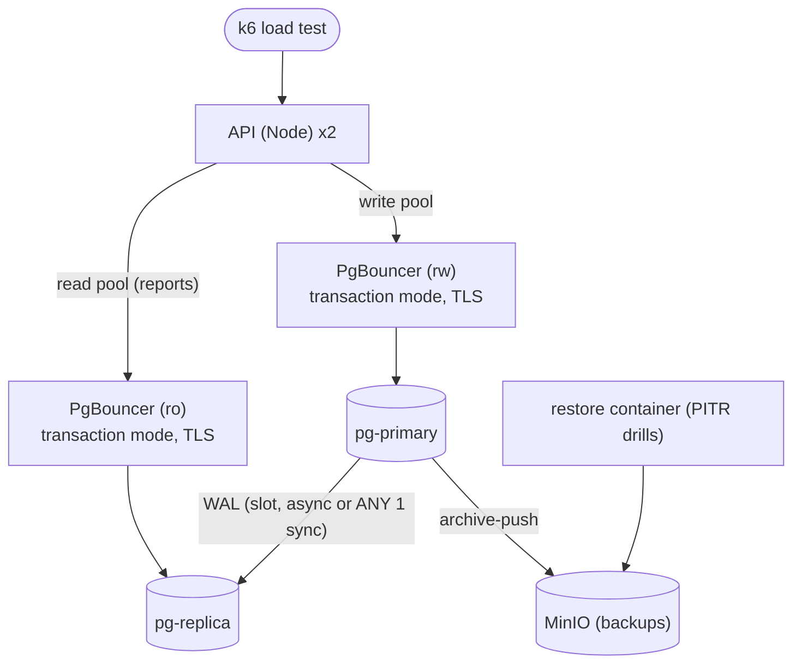
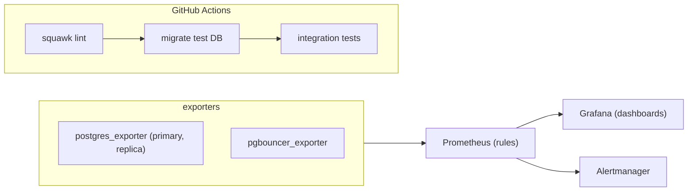

## What a strong solution looks like

A strong capstone reads like an internal platform proposal backed by evidence. Every SLA number (RPO 5 minutes, RTO 1 hour, 99.9%) has a measured value next to it and a link to how it was measured. The stack is reproducible from a clean clone; secrets are not committed; roles are least-privilege and RLS works through PgBouncer in transaction mode; a migration that would have locked `invoices` is caught by CI, and the safe version ships under load with zero failed requests; the restore and failover runbooks have been executed, not just written.

It is also honest about what a single-host compose stack cannot prove (real AZ failure, network partitions, managed-service failover times) and says how that would map onto RDS, Aurora, Cloud SQL or Patroni in production.

## Reference approach

### Topology





Back-of-envelope sizing for 400 tenants: if peak is 300 requests per second with an average of 2 queries at 3 ms each, the database is busy about 300 x 2 x 3 ms = 1.8 seconds of query time per second, so about 2 server connections are active on average. With bursts, a PgBouncer `default_pool_size` of 20 to 30 on the primary is plenty, while the app may hold hundreds of client connections. That is the argument for pooling, and the load test should show it.

### PgBouncer and RLS

```ini
[databases]
erp    = host=pg-primary dbname=erp
erp_ro = host=pg-replica dbname=erp

[pgbouncer]
pool_mode = transaction
max_client_conn = 2000
default_pool_size = 25
client_tls_sslmode = require
client_tls_key_file = /certs/pgbouncer.key
client_tls_cert_file = /certs/pgbouncer.crt
server_tls_sslmode = verify-full
server_tls_ca_file = /certs/ca.crt
auth_type = scram-sha-256
```

In transaction mode the tenant must be set with `set_config('app.tenant_id', $1, true)` inside each transaction. Recent PgBouncer versions (1.21+) support protocol-level prepared statements in transaction mode via `max_prepared_statements`; check this if your driver uses named prepared statements. A test that runs the RLS suite through PgBouncer is the proof.

### Migration pipeline

```yaml
jobs:
  migrations:
    runs-on: ubuntu-latest
    services:
      postgres:
        image: postgres:17
        env: { POSTGRES_PASSWORD: postgres }
        ports: ["5432:5432"]
    steps:
      - uses: actions/checkout@v4
      - run: npx squawk-cli migrations/*.sql
      - run: npm ci && npm run db:bootstrap-roles && npm run db:migrate
      - run: npm test
```

The showcase change, for example adding `invoices.price_list_id NOT NULL REFERENCES price_lists`:

1. Add column nullable (instant, `lock_timeout = '3s'`).
2. Release code that writes it.
3. Batched backfill job, throttled on replica lag.
4. `FOREIGN KEY ... NOT VALID`, then `VALIDATE` in a separate migration.
5. `CHECK (price_list_id IS NOT NULL) NOT VALID`, `VALIDATE`, `SET NOT NULL`, drop the check.
6. `CREATE INDEX CONCURRENTLY` in its own non-transactional migration.

Evidence: the k6 summary for the whole window showing 0 failed requests, and a graph of lock waits staying flat.

### Backups and monitoring

pgBackRest weekly full, daily differential, `archive_timeout = 60`, repository encrypted, retention two fulls. The restore script from the backup drill, run against this stack, with results in the README.

Alert rules worth having (names depend on exporter version):

| Alert | Expression idea | For |
|---|---|---|
| Replica lag | replay lag seconds > 30 | 5m |
| Connections saturated | active / max_connections > 0.8, or PgBouncer `cl_waiting` > 0 | 5m |
| Long transaction | oldest xact age > 600 s | 5m |
| Archiving failing | archiver failed count increasing | 5m |
| XID age | max database age > 500M | 30m |
| Disk full soon | `predict_linear` of free bytes over 6h hits 0 within 7d | 30m |

### Load test results shape

| Config | Throughput | p95 | p99 | Errors | PG backends |
|---|---|---|---|---|---|
| Direct, no pool limit | baseline | | | connection errors at high VUs | hundreds |
| PgBouncer | similar or higher | lower | much lower | ~0 | ~25 |
| PgBouncer + replica for reports | higher for writes | lower for writes | lower | ~0 | ~25 + ~10 |

Your numbers will differ on a laptop; what matters is the direction and an explanation of it. Note that replicas on the same machine share CPU and disk with the primary, which understates the benefit.

### Failover drill

Stop `pg-primary`, run `SELECT pg_promote()` on the replica (or `pg_ctl promote`), switch PgBouncer's `erp` entry to the new primary and `RELOAD`, verify writes, then ensure the old primary cannot rejoin as primary (remove it from routing, rebuild it as a replica with `pg_rewind` or a fresh base backup). Record each step's time. The README must say plainly that this is a manual failover, and that production would use Patroni with etcd, or a managed service, to automate it with consensus and fencing.

## Common mistakes

- **Superuser everywhere** in compose because it was easier, including for the exporter and the app.
- **RLS tested directly against Postgres but not through PgBouncer**, where session state behaves differently.
- **Squawk running but ignored**, with every warning suppressed instead of fixed or justified.
- **Backups configured, never restored**, or restored without verification.
- **Dashboards without alerts**, or alerts never fired once to prove they work.
- **Read-after-write bugs** from sending a just-created invoice's detail page to the replica.
- **Load test numbers without explanation**, or comparing runs with different data sizes.

## Trade-offs worth discussing

- Self-hosted Patroni versus managed (RDS Multi-AZ, Aurora, Cloud SQL HA, Neon, Supabase): control and cost versus operational burden. Which parts of this capstone disappear on managed, and which remain your job?
- Synchronous versus asynchronous replication against the RPO target, and what happens to writes if the only synchronous standby fails.
- Which reads tolerate replica lag, and how to route the rest (session stickiness after writes, LSN-based waits).
- PgBouncer in transaction mode: what breaks (session `SET`, advisory locks held across transactions, `LISTEN`), and the alternatives.
- Alert thresholds: which page a human at night and which go to a dashboard.

## Grade yourself

| Dimension | Strong | Acceptable | Needs work |
|---|---|---|---|
| Topology and routing | Primary, replica, PgBouncer rw/ro, lag-aware routing documented, clean-clone startup | Replica and pooler run, all reads go to primary | Single Postgres, no pooler |
| Security | Six-plus roles, RLS forced and tested through PgBouncer, verified TLS, no committed secrets | Least-privilege app role and RLS, TLS without verification | App as superuser or no RLS |
| Migrations | Squawk gate in CI, retried lock timeouts, risky change shipped under load with 0 errors and evidence | Linter in CI, safe patterns used without load proof | Migrations run on app start, no linter |
| Recovery | PITR drill scripted, RPO/RTO measured vs SLA, failover executed and timed | Restore works, numbers partial | Backups never restored |
| Observability | Provisioned dashboard covering all listed panels, six-plus alerts, at least one fired in a test | Dashboard and a few alerts | Exporter only, no alerts |
| Evidence | README evidence table with links for every claim and an accurate diagram | Results table without links | Claims without proof |

## Going further

- Replace the manual failover with Patroni and etcd (three nodes) and run a network-partition test.
- Deploy the same design to a managed provider and compare failover time and cost against your compose results.
- Add a delayed replica and logical replication of one table to an analytics database.
